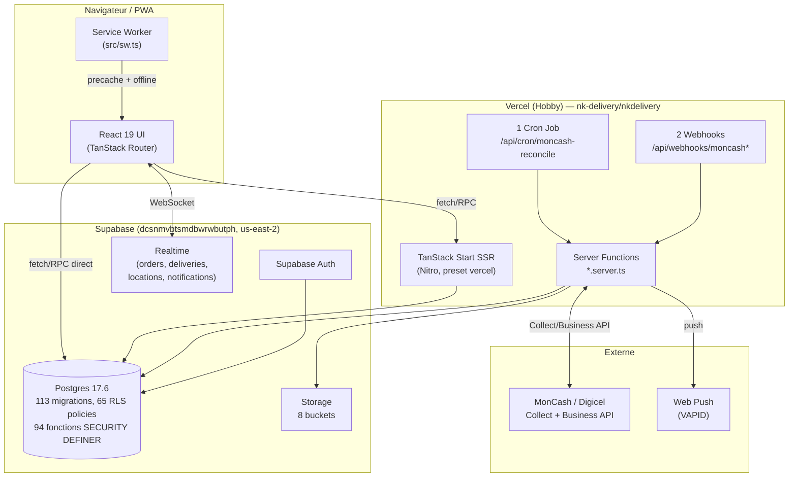
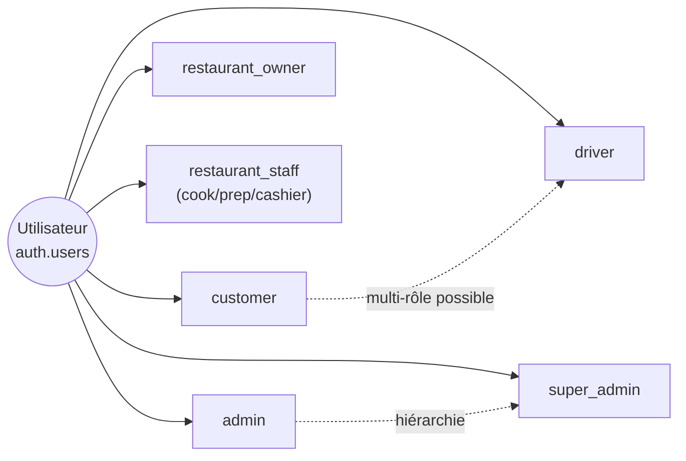
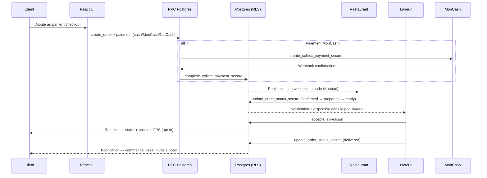
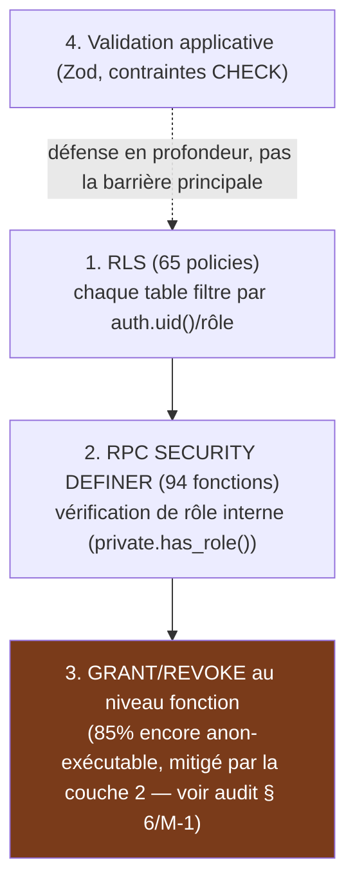
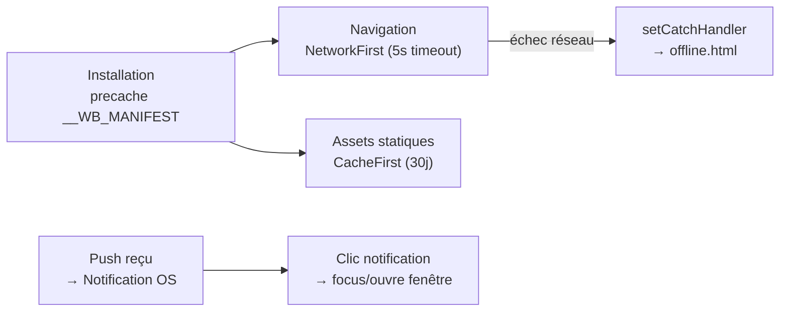

# NK Deliveri — Architecture Finale (v1.0)

## 1. Vue d'ensemble

**Points clés confirmés par l'audit** :

- `VITE_SUPABASE_URL` est inliné au build dans le bundle client **et** serveur (Vite) — SSR et navigateur ciblent la même instance Supabase automatiquement.
- **Zéro Supabase Edge Function** — toute la logique serveur passe par des Server Functions TanStack Start (`.server.ts`, jamais importées statiquement dans une route) ou des RPC Postgres `SECURITY DEFINER`.
- Un seul job cron (`vercel.json`, quotidien — limite du plan Vercel Hobby), actuellement inerte (décaissement MonCash non activé).

## 2. Modèle de rôles

Un même compte peut cumuler plusieurs rôles (`user_roles`, table n-n) — le sélecteur de dashboard multi-rôle (`activeRoleForPath()`) résout quel dashboard afficher depuis l'URL. `dashboard.customer.tsx` est la seule famille de layout sans `requireRole()` explicite (§ L-3 de l'audit) — RLS reste la barrière réelle dans tous les cas.

## 3. Flux — commande client de bout en bout

## 4. Sécurité — modèle en couches

La couche 3 est le point faible identifié par l'audit (M-1) : le grant `anon` large sur 80/94 fonctions signifie que la sécurité repose presque entièrement sur la couche 2 (le corps de chaque fonction), sans deuxième filet au niveau privilège Postgres.

## 5. Storage — buckets et politique d'accès

| Bucket                   | Public | Contenu                           |
| ------------------------ | ------ | --------------------------------- |
| `avatars`                | oui    | Photos de profil                  |
| `restaurant-assets`      | oui    | Logo/cover restaurant             |
| `menu-photos`            | oui    | Photos plats                      |
| `driver-documents`       | non    | Permis/pièces d'identité livreur  |
| `dispute-attachments`    | non    | Preuves de litige                 |
| `payout-proofs`          | non    | Preuves de décaissement           |
| `payment-proofs`         | non    | Preuves de paiement (cash/manuel) |
| `order-chat-attachments` | non    | Pièces jointes du chat commande   |

## 6. PWA — cycle de vie du Service Worker

## 7. Dette d'architecture identifiée (voir audit complet pour le détail)

- Grant `anon` systémique sur les fonctions `SECURITY DEFINER` (M-1).
- Moteur de notifications adopté à 12/44 sites d'appel seulement (M-2).
- Dashboards MonCash/Finance en pull, pas en push (M-3).
- Absence de sauvegarde automatique/PITR au niveau infrastructure (H-1 infra).
