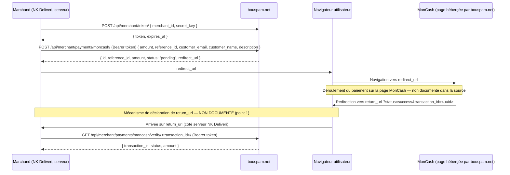

# NK Deliveri — MonCash Automatik — Phase 0.5 — Points bloquants

**Date** : 2026-08-03
**Source unique analysée** : `c:\tmp\API.docx` (extraction intégrale, texte reproduit ci-dessous à chaque point pour vérifiabilité — rien n'est cité de mémoire).
**Portée** : relecture stricte, point par point. Aucune proposition d'implémentation. Aucun comportement absent du document n'est supposé.

---

## 1. `return_url`

**Ce que la documentation dit exactement** :

> "After payment, user is redirected to your `return_url`: `https://your-site.com/callback?status=success&transaction_id=<uuid>`"

C'est la **seule** phrase du document mentionnant `return_url`.

**Ce qui manque** :

- Le corps de requête documenté pour `POST /api/merchant/payments/moncash/` contient exactement 5 champs : `amount`, `reference_id`, `customer_email`, `customer_name`, `description`. **`return_url` n'y figure pas.**
- Aucune section "configuration du compte marchand" ou "dashboard" n'existe dans le document.
- Aucune convention implicite n'est énoncée (ex. "toujours `{votre domaine}/callback`").

**Conclusion pour ce point** : la documentation affirme qu'un `return_url` existe et qu'il est utilisé, **sans jamais dire comment il est déclaré**. Les trois hypothèses possibles (envoyé dans Create Payment / configuré côté compte marchand bouspam.net / fixe par convention) sont **également non étayées** par le texte — aucune ne peut être retenue sans confirmation.

**Impact sur l'architecture** : **bloquant direct**. Sans savoir comment déclarer le `return_url`, il est impossible de concevoir la nouvelle route de retour (identifiée en Phase 0 comme un composant à créer, puisqu'aucune route équivalente n'existe aujourd'hui) — on ne sait pas si son chemin est libre (ex. `/checkout/return`) ou imposé par une configuration externe déjà fixée par le fournisseur.

---

## 2. Callback serveur

**Ce que la documentation dit exactement** : la seule section relative à un "retour" après paiement est celle citée au point 1 — une redirection navigateur. Le mot "webhook" **n'apparaît nulle part** dans le document. Le mot "callback" apparaît uniquement comme titre de cette section de redirection navigateur.

**Ce qui manque** :

- Aucune URL de webhook à enregistrer.
- Aucun format de payload de notification serveur-à-serveur.
- Aucune mention de notification asynchrone d'aucune sorte.

**Conclusion pour ce point** : **aucun webhook serveur, callback signé, ou notification asynchrone n'est documenté.** Le seul mécanisme de retour d'information après paiement, tel que documenté, est la redirection du navigateur de l'utilisateur (non fiable en tant que source de vérité, l'URL de redirection étant manipulable côté client) et l'appel actif à `GET verify/<transaction_id>`.

**Impact sur l'architecture** : la Phase Callback Service de la mission ("créer une route dédiée... vérifier la requête... vérifier le transaction_id") doit être repensée : il n'y a pas de requête serveur entrante à authentifier par signature (contrairement à l'intégration Digicel existante, qui utilise — de façon elle-même non confirmée par Digicel — un webhook signé HMAC). La seule action fiable possible côté serveur est un appel sortant vers `GET verify/<transaction_id>` déclenché par l'arrivée de l'utilisateur sur `return_url`.

---

## 3. Authentification

**Ce que la documentation dit exactement** :

```
POST /api/merchant/token/
Request:  { "merchant_id": "...", "secret_key": "..." }
Response: { "success": true, "data": { "token": "eyJhbGci...", "expires_at": "2026-01-30T15:30:00+00:00" } }
```

**Ce qui manque** :

- **Durée de vie** : aucune durée n'est énoncée (ex. "valide 1 heure") — seul un exemple de valeur absolue `expires_at` est montré, qui ne permet de déduire aucune règle générale.
- **Renouvellement** : aucune méthode de rafraîchissement (pas de `refresh_token`, pas de section "renewal"). La seule action documentée pour obtenir un token est de rappeler `POST /api/merchant/token/` — mais le document ne dit jamais explicitement que c'est la méthode de renouvellement prévue, ni s'il existe une limite au nombre de tokens actifs simultanés.
- **Révocation** : aucun endpoint ni aucune mention de révocation de token.
- **Erreurs possibles** : aucun exemple de réponse en cas de `merchant_id`/`secret_key` invalide n'est fourni (ni code HTTP, ni corps de réponse).

**Conclusion pour ce point** : seul le mécanisme d'obtention initiale du token est documenté. Tout le cycle de vie autour (durée, renouvellement, révocation, échec) est absent.

**Impact sur l'architecture** : la couche "Authentication" demandée par la mission ("gérer son expiration, renouveler automatiquement le token") ne peut être conçue avec certitude que sur la base de `expires_at` (comparer à l'heure courante, redemander un token quand dépassé) — une stratégie plausible, mais dont la mission interdit explicitement de présumer qu'elle est correcte sans confirmation, puisque "renouveler automatiquement" n'est décrit nulle part dans le document.

---

## 4. Verify

**Ce que la documentation dit exactement** :

```
GET /api/merchant/payments/moncash/verify/<transaction_id>/
Response: { "success": true, "data": { "transaction_id": "uuid", "status": "completed", "amount": "500.00" } }
Status values: pending | completed | failed
```

**Ce qui manque** :

- **À quel moment appeler Verify** : non précisé. Le document ne dit pas "appeler Verify après avoir reçu le callback", ni "appeler Verify en polling avant tout callback" — cette section est indépendante de la section Callback dans le document, sans lien explicite entre les deux.
- **Combien de fois** : aucune limite, aucun rate limit énoncé.
- **Stratégie de retry** : totalement absente — aucune mention de délai entre tentatives, de nombre maximal d'essais, ni de comportement attendu en cas d'échec réseau.

**Conclusion pour ce point** : l'existence et le contrat de réponse de l'endpoint sont documentés ; **tout ce qui concerne la manière de l'utiliser en pratique (déclenchement, cadence, résilience) est absent.**

**Impact sur l'architecture** : le Verify Service demandé par la mission ne peut fonder sa logique de déclenchement que sur une hypothèse ("appeler après réception du callback navigateur") qui, bien que raisonnable, reste non confirmée par le texte.

---

## 5. Idempotence

**Ce que la documentation dit exactement** : rien. Le mot "idempotent" n'apparaît pas. Aucune section ne traite de doublons.

**Ce qui manque** :

- **Unicité de `transaction_id`** : présenté comme un `"uuid"` dans les réponses, ce qui suggère une génération serveur unique par construction, mais le document ne l'affirme jamais explicitement comme une garantie contractuelle.
- **Unicité de `reference_id`** : notre propre identifiant, envoyé dans Create Payment (`"ORDER-123"` dans l'exemple). **Rien n'indique** si soumettre deux fois le même `reference_id` est rejeté, silencieusement dupliqué, ou retourne la transaction existante.
- **Comportement lors d'un double callback** : puisqu'aucun webhook n'existe (point 2), et que le callback documenté est une simple redirection navigateur, un utilisateur qui revient en arrière ou recharge la page `return_url` produirait potentiellement une seconde "réception" du même callback — le document ne dit rien sur la manière dont cela doit être géré côté marchand.

**Conclusion pour ce point** : **aucune garantie d'idempotence n'est documentée**, à aucun niveau.

**Impact sur l'architecture** : c'est le point le plus critique pour une intégration financière. L'intégration Digicel existante s'appuie explicitement sur une contrainte d'unicité d'`orderId` documentée (bien que côté Digicel, pas bouspam.net) pour sa réconciliation après timeout — rien d'équivalent ne peut être présumé ici. La déduplication devra reposer entièrement sur la logique déjà existante côté NK Deliveri (le `WHERE status = 'pending'` de `complete_collect_payment_secure`, déjà en place et indépendant du fournisseur), pas sur une garantie du fournisseur.

---

## 6. Erreurs

**Ce que la documentation dit exactement** : chacun des trois exemples de réponse (token, create payment, verify) montre exclusivement `"success": true`. **Aucun exemple de réponse d'erreur n'est présent dans le document, à aucun endroit.**

**Ce qui manque** :

- Aucun code HTTP n'est mentionné explicitement nulle part dans le document — même les cas de succès n'indiquent pas "200 OK" en toutes lettres.
- Aucun code d'erreur métier (ex. `"error_code": "INVALID_TOKEN"`) n'est montré.
- Aucun format de corps de réponse d'erreur (`{"success": false, ...}` par déduction du champ `success` vu dans les succès, mais jamais confirmé pour un cas d'échec réel).

**Conclusion pour ce point** : **zéro documentation d'erreur.** Toute liste de codes HTTP ou d'erreurs métier serait une invention pure — aucune n'est produite dans ce rapport, conformément à l'instruction.

**Impact sur l'architecture** : le client HTTP ne peut pas distinguer aujourd'hui une erreur transitoire (à retry) d'une erreur définitive (à ne pas retry) — cette distinction, présente et documentée dans le client Digicel existant (retry uniquement sur 429/5xx), ne peut pas être reproduite ici sans savoir quels codes HTTP bouspam.net utilise réellement.

---

## 7. Sécurité

**Ce que la documentation dit exactement** : le seul élément relatif à la sécurité dans tout le document est l'usage du `secret_key` pour obtenir un `token`, et l'usage de ce `token` en `Authorization: Bearer <token>` sur les deux appels suivants.

**Ce qui manque** :

- **Signature** : aucune mention, à aucun endroit du document (ni sur la création de paiement, ni sur le callback, ni sur verify).
- **Hash/HMAC** : absent.
- **Timestamp anti-rejeu** : `expires_at` est un timestamp d'expiration de token, pas un mécanisme de protection contre le rejeu d'une requête ou d'un callback.
- Le callback (redirection navigateur, point 2) ne porte **aucune preuve d'authenticité** dans son URL documentée (`?status=success&transaction_id=<uuid>` — deux valeurs en clair, non signées).

**Conclusion pour ce point** : le seul mécanisme de sécurité documenté est le Bearer token pour les appels API sortants authentifiés (Auth, Create Payment, Verify). **Rien ne protège le callback redirigé contre une falsification** — un tiers pourrait construire manuellement une URL `.../callback?status=success&transaction_id=<n'importe-quel-uuid>` et la faire visiter à un navigateur.

**Impact sur l'architecture** : ceci confirme et durcit un principe déjà énoncé en Phase 0 — **le contenu du callback (query params) ne doit jamais être traité comme une source de vérité.** La seule confirmation valable d'un paiement est un appel serveur `GET verify/<transaction_id>` avec le Bearer token, dont la réponse est authentifiée par la possession du token (donc du `secret_key`), pas par une signature sur le callback lui-même.

---

## 8. Diagramme — flux strictement tel que documenté

Aucun élément non documenté n'est ajouté ci-dessous (pas de flèche "webhook" en pointillé, pas d'étape de signature) :



Aucune branche webhook, aucune branche de signature, aucune branche de retry n'est représentée — ces éléments ne sont pas dans la documentation source.

---

## Conclusion

# 🔴 Documentation insuffisante

Sur les 8 points vérifiés, **1 seul est complet** (le contrat de réponse de Verify — statuts, champs). Les 7 autres présentent au moins une lacune bloquante ou significative, dont deux réellement bloquantes pour toute implémentation fiable (`return_url` § 1, absence totale de sécurité du callback § 7) et une bloquante pour la fiabilité financière (idempotence § 5).

### Liste exacte à demander au fournisseur (bouspam.net) avant toute implémentation

1. Comment déclare-t-on le `return_url` ? (paramètre de requête non documenté, réglage de compte marchand, ou fixe par convention — et si oui, laquelle)
2. Existe-t-il un webhook serveur-à-serveur en plus de la redirection navigateur ? Si oui : URL à enregistrer, méthode HTTP, format du payload, mécanisme de signature.
3. Durée de vie exacte d'un token (en secondes/minutes), et confirmation que rappeler `POST /api/merchant/token/` est la méthode de renouvellement prévue. Existe-t-il une limite de tokens actifs simultanés ou un endpoint de révocation ?
4. Un `reference_id` déjà utilisé est-il rejeté, dédupliqué automatiquement, ou accepté en double ? Quel est le comportement exact ?
5. Quels sont les codes HTTP et le format exact des réponses d'erreur (token invalide, paramètres invalides, montant invalide, transaction introuvable) ? Un exemple de réponse d'erreur réelle pour chacun des 3 endpoints.
6. Existe-t-il une politique de rate limiting (nombre de requêtes/minute) sur l'un des 3 endpoints ?
7. Le callback de redirection porte-t-il un moyen de vérifier son authenticité (signature, token à usage unique dans l'URL), ou faut-il exclusivement se fier à un appel actif à Verify après réception ?
8. Existe-t-il une garantie de délai entre le paiement effectif sur la page MonCash et la disponibilité du statut `completed` via Verify (latence de propagation) ?

**Aucune implémentation ne doit commencer tant que les points 1, 2 et 7 (les plus structurants pour l'architecture) ne sont pas clarifiés par le fournisseur.** Les points 3–6 et 8 peuvent être découverts empiriquement en sandbox une fois 1/2/7 résolus, mais ne devraient pas non plus être laissés à la simple observation pour une intégration financière en production.
