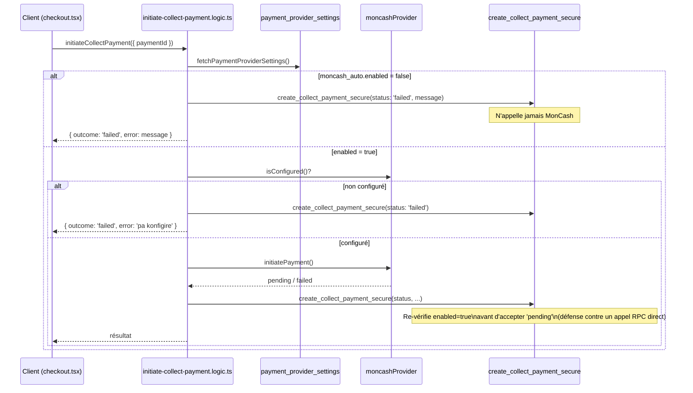

# Payment Provider Hardening — Architecture

**Date** : 2026-08-03

---

## 1. Principe

Une seule couche décide si une méthode de paiement checkout est utilisable : `payment_provider_settings` (base de données), lue exclusivement via `PaymentProviderAvailabilityService` (`src/lib/payment-provider-availability.ts`). Le frontend l'affiche ; le backend l'impose — indépendamment l'un de l'autre, jamais l'un se reposant sur l'autre.

```mermaid
flowchart TB
    subgraph DB["Base de données (source de vérité)"]
        T["payment_provider_settings\n(kach, moncash, natcash, moncash_auto)"]
    end

    subgraph Service["PaymentProviderAvailabilityService\n(payment-provider-availability.ts)"]
        F1["fetchPaymentProviderSettings()"]
        F2["isProviderEnabled()"]
        F3["getDefaultProvider()"]
        F4["updatePaymentProviderSetting()"]
    end

    subgraph Frontend["Frontend (affichage uniquement)"]
        Hook["usePaymentProviderAvailability()"]
        Checkout["checkout.tsx\n(boutons visible/enabled/badge)"]
        Admin["dashboard.admin.payment-providers.tsx\n(Fournisseurs)"]
    end

    subgraph Backend["Backend (application réelle)"]
        Logic["initiate-collect-payment.logic.ts"]
        RPC1["create_collect_payment_secure\n(hardened: refuse 'pending' si disabled)"]
        RPC2["update_payment_provider_setting_secure\n(admin uniquement)"]
    end

    T -->|SELECT, RLS lecture publique| F1
    F1 --> F2 & F3
    F2 & F3 --> Hook --> Checkout
    F1 --> Admin
    Admin -->|toggle| F4 --> RPC2 -->|UPDATE, admin-only| T

    Logic -->|1. vérifie enabled AVANT isConfigured\net avant tout import du provider| F2
    Logic -->|2. si refusé: journalise via| RPC1
    Logic -->|3. si accepté: appelle MonCash puis| RPC1
    RPC1 -->|3. vérifie enabled à nouveau,\ndéfense en profondeur| T

    style Backend fill:#1a2e1a
    style DB fill:#2e1a1a
```

## 2. Flux backend — refus vs. acceptation

## 3. Schéma SQL

### `payment_provider_settings`

| Colonne | Type | Note |
|---|---|---|
| `id` | `uuid` PK | `gen_random_uuid()` |
| `provider` | `text` UNIQUE | `kach` \| `moncash` \| `natcash` \| `moncash_auto` |
| `visible` | `boolean` | Affiché dans la grille checkout (non utilisé aujourd'hui, `true` partout — prévu pour un futur "masquer entièrement") |
| `enabled` | `boolean` | **Le flag réellement appliqué** |
| `default_provider` | `boolean` | Un seul `true` possible — `UNIQUE INDEX ... WHERE default_provider = true` |
| `maintenance_message` | `text NULL` | Affiché quand `enabled = false` |
| `updated_by` | `uuid REFERENCES auth.users` | Traçabilité |
| `updated_at`, `created_at` | `timestamptz` | |

**RLS** : `SELECT` pour `anon, authenticated` (lecture publique — checkout accessible avant connexion). Aucune policy d'écriture — seule la RPC `SECURITY DEFINER` peut modifier.

**Migrations** :
- `20260803120000_payment_provider_settings.sql` — table, index, RLS, seed, `update_payment_provider_setting_secure`.
- `20260803130000_harden_create_collect_payment_provider_check.sql` — `CREATE OR REPLACE` de `create_collect_payment_secure` (RPC déjà existante), ajout d'un seul `IF` bloquant un `_status='pending'` fabriqué pendant que `moncash_auto` est désactivé.

### RPC

| RPC | Accès | Rôle |
|---|---|---|
| `update_payment_provider_setting_secure(_provider, _visible?, _enabled?, _maintenance_message?, _set_as_default?)` | `authenticated`, vérifie `admin`/`super_admin` en interne | Seul chemin d'écriture |
| `create_collect_payment_secure` (durcie) | `authenticated`, vérifie propriété du paiement | Refuse un `pending` si `moncash_auto.enabled = false`, quel que soit l'appelant |

## 4. Pourquoi deux tables "provider" coexistent

`payment_providers` (existante, inchangée) gouverne le moteur de **décaissement** (admin → restaurant/livreur). `payment_provider_settings` (nouvelle) gouverne les **méthodes de checkout** (client → plateforme). Détail complet : `docs/PAYMENT_PROVIDER_HARDENING_PHASE0_AUDIT.md` § 1.

## 5. Ce qui n'a pas changé

`PaymentProvider` (interface), `moncashProvider`/`natcashProvider`/`manualProvider`, `payment_transactions`, le flux Wallet/Commission/Décaissement/Notifications/Chat/GPS/Realtime, `payment_providers` — zéro modification, confirmé par l'audit Phase 0 et par `npm run verify` vert avant/après.
