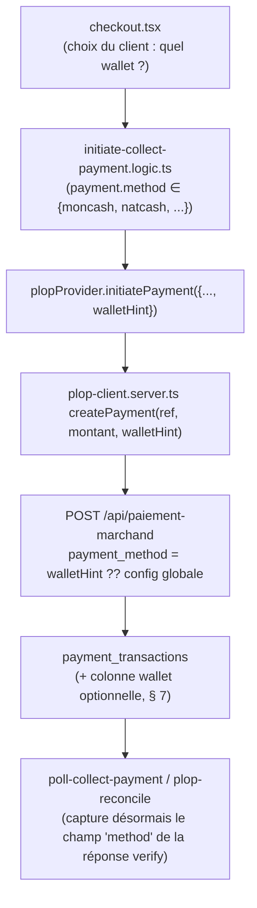

# NK Deliveri — PLOP Multi-Wallet — Audit Phase 0

**Date** : 2026-08-04
**Portée** : audit uniquement, comme demandé explicitement. **Aucun code, aucune migration, aucun commit.** Fait suite à `docs/PLOP_PHASE0_AUDIT.md` → `PLOP_PHASE3_WIRING_REPORT.md` (le provider PLOP Collect est en production, activé, testé avec succès aujourd'hui — voir mémoire de session).
**Source documentaire** : le PDF `plop plop.pdf` fourni dans ce message (12 pages, `plopplop.solutionip.app/paiement-doc`, v1.4/1.5) — comparé ligne à ligne avec `docs/PLOP_PHASE0_AUDIT.md` (déjà basé sur la même page web). **Aucune divergence de contenu trouvée** entre les deux sources — la documentation n'a pas changé depuis le premier audit.

---

## 1. Résumé exécutif

**Le constat de départ de cette mission est en partie inexact et doit être corrigé avant toute implémentation.** Deux prémisses ne sont pas supportées par la documentation PLOP officielle (relue intégralement une troisième fois pour cet audit) :

1. **"PLOP Gateway → wallet adapters (MonCash / NatCash / KashPay)"** — cette architecture suppose que PLOP expose un comportement, un format de requête/réponse, ou une authentification différente par portefeuille, nécessitant un adaptateur séparé par wallet. **Ce n'est pas le cas.** `POST /api/paiement-marchand` est un **unique endpoint**, avec un **unique champ** `payment_method` (`moncash`|`kashpaw`|`natcash`|`all`) qui sélectionne simplement quelle option apparaît sur la page de paiement hébergée par PLOP. Requête, réponse, codes d'erreur, authentification (aucune) sont **strictement identiques** quel que soit le wallet. PLOP **est déjà** l'abstraction multi-wallet — construire des "wallet adapters" par-dessus dupliquerait une abstraction qui existe déjà à un niveau plus bas, pour un bénéfice nul (voir § 5).
2. **"Implémenter webhook unifié : /api/webhooks/plop"** — **PLOP ne documente aucun webhook, nulle part, dans les 12 pages fournies.** Confirmé pour la troisième fois (Phase 0, Phase 2 remédiation, et cette relecture). Le système actuel a été délibérément construit sans webhook (poll adaptatif côté client + cron de réconciliation quotidien), précisément parce que ce mécanisme n'existe pas. Créer une route `/api/webhooks/plop` créerait un endpoint que PLOP n'appellera jamais — du code mort, pas une correction.

**Ce qui est réellement vrai dans le constat de la mission** : le système **est** aujourd'hui codé en dur sur un seul wallet (`moncash`), mais **par choix de périmètre déjà acté avec vous** (mission originale : _"L'intégration doit uniquement remplacer le provider MonCash Automatik"_), pas par une hypothèse erronée non examinée. Étendre à NatCash/KashPay est un **changement de périmètre réel et légitime à considérer**, pas un bug à corriger silencieusement — d'où cet audit avant tout code, exactement comme demandé.

**Le renommage du dashboard admin ("MonCash" → "Peman Otomatik") est déjà fait** — livré et déployé en production dans la session en cours, précisément pour cette même raison (PLOP peut router vers plusieurs wallets). Rien à faire de plus sur ce point.

---

## 2. Audit — Payment Providers

| Fichier                                                                                                  | Constat                                                                                                                                                                                                                                                                                                                                                                                                                  |
| -------------------------------------------------------------------------------------------------------- | ------------------------------------------------------------------------------------------------------------------------------------------------------------------------------------------------------------------------------------------------------------------------------------------------------------------------------------------------------------------------------------------------------------------------ |
| `src/lib/payment-providers/types.ts`                                                                     | Interface `PaymentProvider` déjà générique — `initiatePayment(input)`, `checkStatus(ref)`, etc. Aucune notion de "wallet" dans le contrat, à dessein : le wallet est un détail d'implémentation de _comment_ le provider traite un paiement, pas une propriété de l'interface elle-même. **Aucun changement requis ici.**                                                                                                |
| `src/lib/payment-providers/plop-provider.server.ts`                                                      | Implémente `PaymentProvider` pour PLOP. `initiatePayment()`/`checkStatus()` sont **déjà wallet-agnostiques** — ils ne référencent jamais "moncash" en dur, ils délèguent entièrement à `plop-client.server.ts`.                                                                                                                                                                                                          |
| `src/lib/payment-providers/plop-client.server.ts`                                                        | **C'est ici, et seulement ici, que le wallet est fixé.** `createPayment()` (ligne ~260) lit `paymentMethod` depuis `getPlopConfig()` — une **valeur globale unique pour toute l'application**, jamais un paramètre par appel. `verifyPayment()` ne capture pas le champ `method` que PLOP retourne pourtant dans sa réponse `paiement-verify` (voir § 4.3) — il est présent dans `raw` mais pas exposé comme champ typé. |
| `src/lib/payment-providers/plop-config.server.ts`                                                        | `PLOP_PAYMENT_METHOD` (env var optionnelle, défaut `"moncash"`) — **un seul wallet pour tout le déploiement**, pas par transaction, pas par restaurant, pas par choix client. C'est la définition précise de l'hypothèse "MonCash uniquement" dans le code actuel.                                                                                                                                                       |
| `manual-provider.server.ts`, `natcash-provider.server.ts`, `moncash-provider.server.ts` (legacy Digicel) | Non concernés — ce sont les rails **manuels** (preuve de paiement) et le canal **décaissement** Digicel, structurellement séparés du Collect PLOP (Phase 0/1, confirmé de nouveau, hors périmètre de cette mission).                                                                                                                                                                                                     |

**Conclusion § 2** : aucune "duplication d'hypothèse MonCash" à corriger dans la couche `PaymentProvider`/`plopProvider` — elle est déjà correcte. Le point réel à traiter est **un seul endroit** : `payment_method` est une constante de configuration globale au lieu d'être paramétrable par appel.

---

## 3. Audit — Initiate Payment Flow (`initiate-collect-payment.logic.ts`)

- `payment.method !== "moncash"` (ligne ~53) — **rejette explicitement tout ce qui n'est pas `moncash`** avant même d'appeler PLOP. C'est la porte d'entrée qui empêche aujourd'hui un client de payer via PLOP/NatCash ou PLOP/KashPay, quel que soit ce que `plop-client.server.ts` pourrait techniquement faire.
- `plopProvider.initiatePayment({direction:"collect", amount: payment.amount, reference})` — **ne transmet aucune information de wallet** ; `plop-client.server.ts` retombe donc systématiquement sur la config globale.
- Le reste du flux (gate `payment_provider_settings`, `create_collect_payment_secure`, gestion `already_confirmed`/`pending`/`failed`) est **entièrement wallet-agnostique** — aucun changement requis pour supporter plusieurs wallets, à condition que `payment.method` puisse valoir autre chose que `'moncash'` en amont.

**Conclusion § 3** : le point de blocage exact est cette unique ligne `payment.method !== "moncash"`, reflet direct du fait que `checkout.tsx` ne propose aujourd'hui qu'un seul rail `moncash` pour "Peman Otomatik" (§ 4.2).

---

## 4. Audit — Webhook Handlers, Schéma DB, Variables d'environnement

### 4.1 Webhook

- `src/routes/api.webhooks.moncash.collect.ts` + `src/lib/payment-providers/moncash-collect-webhook-handler.server.ts` : **dormants, jamais appelés par PLOP** (confirmé § 1). `plopProvider.verifyWebhook()` refuse systématiquement, honnêtement, par conception (Phase 2/3).
- **Il n'existe et ne doit exister aucune route `/api/webhooks/plop`** tant que PLOP ne documente pas un mécanisme réel — l'implémenter inventerait un contrat qui n'existe pas.

### 4.2 Schéma base de données

| Table/Enum                              | Constat                                                                                                                                                                                                                                                                                                                                                                                                                                                               |
| --------------------------------------- | --------------------------------------------------------------------------------------------------------------------------------------------------------------------------------------------------------------------------------------------------------------------------------------------------------------------------------------------------------------------------------------------------------------------------------------------------------------------- |
| `public.payment_method` (ENUM Postgres) | `CREATE TYPE public.payment_method AS ENUM ('stripe','moncash','natcash','kach')` — **`kashpaw` n'existe pas du tout dans l'énumération**. Étendre à KashPay nécessiterait `ALTER TYPE ... ADD VALUE`, une vraie migration de schéma, pas un simple changement de code. `natcash` existe déjà — un paiement automatique PLOP/NatCash est structurellement plus proche d'être supporté sans migration de schéma que KashPay.                                           |
| `payment_transactions`                  | Colonnes `provider` (`'moncash_api'`, un code de fournisseur, pas un wallet), `external_reference`, `provider_transaction_id`, `webhook_data jsonb`. **Aucune colonne ne capture quel wallet PLOP a effectivement utilisé.** Le champ `method` que PLOP retourne dans `paiement-verify` (§ 4.3) atterrit dans `webhook_data` (le `raw` complet y est stocké par `plop-reconcile.server.ts`/`poll-collect-payment.logic.ts`) mais n'est pas une colonne interrogeable. |
| `payment_provider_settings`             | 4 lignes (`kach`/`moncash`/`natcash`/`moncash_auto`) — un seul provider `moncash_auto` représente "Peman Otomatik" aujourd'hui. Aucune notion de wallet ici non plus — c'est un choix de _méthode de checkout_, pas de _wallet PLOP_.                                                                                                                                                                                                                                 |

### 4.3 Le champ `method` de PLOP — capacité existante non exploitée

La réponse `paiement-verify` documentée (PDF, page 3 et `docs/PLOP_PHASE0_AUDIT.md` § 7) contient :

```json
{
  "status": true,
  "montant": 250,
  "trans_status": "no",
  "id_transaction": "...",
  "method": "moncash",
  "id_client": null
}
```

**PLOP indique déjà, après coup, quel wallet le client a réellement utilisé** (pertinent surtout si `payment_method: "all"` était envoyé à la création, laissant le client choisir). `verifyPayment()` (`plop-client.server.ts`) ne remonte pas ce champ comme propriété typée de `PlopVerifyResult` — il est présent uniquement dans `raw`. C'est une lacune concrète, indépendante de toute décision d'extension de périmètre, qui devra être comblée si le wallet réellement utilisé doit un jour être tracé.

### 4.4 Variables d'environnement

`.env.example` : `PLOP_CLIENT_ID`, `PLOP_CLIENT_SECRET` (requis), `PLOP_PAYMENT_METHOD` (optionnel, un seul wallet global). Aucune variable par wallet — cohérent avec l'architecture actuelle à un seul rail.

---

## 5. Correction — pourquoi "wallet adapters" séparés seraient une régression architecturale

La mission propose :

```
PLOP Gateway
 |
 wallet adapters:
 - MonCash
 - NatCash
 - KashPay
```

Ceci reproduirait, à l'intérieur de l'intégration PLOP, exactement le pattern `moncash-provider.server.ts` / `natcash-provider.server.ts` qui existe pour les **fournisseurs manuels/Digicel** — où cette séparation est justifiée parce que **chaque fournisseur a une API, une authentification et un format différents**. Ce n'est **pas** le cas ici : les trois wallets PLOP partagent le même endpoint, le même schéma de requête, le même schéma de réponse, la même absence d'authentification, les mêmes codes d'erreur. Un "adapter MonCash" et un "adapter NatCash" pour PLOP seraient **deux copies quasi identiques d'un même code**, violant directement le principe DRY que ce projet applique systématiquement ailleurs (`docs/PAYMENT_PROVIDER_DEVELOPER_GUIDE.md`).

**La bonne abstraction est un paramètre, pas une hiérarchie de classes** : `createPayment(reference, amount, walletHint?)` où `walletHint` est simplement l'une des 4 valeurs déjà documentées par PLOP (`moncash`|`kashpaw`|`natcash`|`all`), avec la config globale actuelle comme valeur par défaut si non précisé.

---

## 6. Architecture proposée (revue, pas encore implémentée)



**Un seul point de paramétrage réel à modifier** : `createPayment()`/`plop-client.server.ts`, plus la porte `payment.method !== "moncash"` dans `initiate-collect-payment.logic.ts`, plus l'UI `checkout.tsx` si on veut réellement exposer plusieurs choix au client. **Aucun "wallet adapter" séparé, aucune duplication de client HTTP.**

---

## 7. Propositions de schéma (à valider — rien exécuté)

| Option                                                | Portée                                                                                                                                                                                                                                                                                                               | Migration requise                                                   |
| ----------------------------------------------------- | -------------------------------------------------------------------------------------------------------------------------------------------------------------------------------------------------------------------------------------------------------------------------------------------------------------------- | ------------------------------------------------------------------- |
| **A — Traçabilité seule** (recommandé pour commencer) | Ajouter `payment_transactions.plop_wallet text NULL` (rempli depuis le champ `method` de `paiement-verify`, § 4.3), sans changer le comportement client. Permet de savoir après coup quel wallet a été utilisé, même si `payment_method:"moncash"` reste fixe côté création.                                         | Migration additive triviale, faible risque.                         |
| **B — Sélection NatCash par le client**               | Étendre `checkout.tsx`/`initiate-collect-payment.logic.ts` pour autoriser `payment.method === "natcash"` en plus de `"moncash"` vers PLOP. **Aucune migration de schéma** (`natcash` existe déjà dans l'ENUM) — changement de code uniquement.                                                                       | Aucune.                                                             |
| **C — Support KashPay**                               | Nécessite `ALTER TYPE public.payment_method ADD VALUE 'kashpaw'` (ou équivalent) — impact plus large : UI, `create_order_secure`, tout endroit qui fait un `switch`/`CASE` sur `payment_method` (décaissement, dashboards financiers, etc. — audit dédié nécessaire avant d'y toucher, hors périmètre de cet audit). | Migration de schéma réelle, impact plus large à auditer séparément. |

**Aucune de ces options n'a été implémentée.** Le choix entre elles (et le go/no-go sur l'extension du périmètre elle-même) vous revient.

---

## 8. Fichiers qui seraient modifiés (si le périmètre est étendu — liste, pas exécution)

- `src/lib/payment-providers/plop-client.server.ts` — `createPayment()` accepte un `walletHint` optionnel ; `verifyPayment()` expose `method` comme champ typé.
- `src/lib/payment-providers/plop-provider.server.ts` — relaie le wallet choisi (nouveau champ optionnel sur `InitiatePaymentInput` ou paramètre dédié — à trancher, impact sur `types.ts` partagé avec les autres providers à évaluer précisément pour ne rien casser côté MonCash Manyèl/NatCash Manyèl/décaissement).
- `src/lib/initiate-collect-payment.logic.ts` — la garde `payment.method !== "moncash"` devient `!["moncash","natcash"].includes(payment.method)` (Option B) ou reste inchangée (Option A seule).
- `src/routes/checkout.tsx` — si Option B : nouveau choix wallet dans l'UI "Peman Otomatik", ou un unique bouton envoyant `payment_method:"all"` et laissant PLOP proposer le choix (à décider — implication UX à valider avec vous, pas une décision technique pure).
- `supabase/migrations/<timestamp>_plop_wallet_tracking.sql` — Option A (et/ou B si un enum change).
- Tests : `plop-client.test.ts`, `plop-provider.test.ts`, `initiate-collect-payment.test.ts` — nouveaux cas pour chaque wallet activé.

**Aucun de ces fichiers n'a été touché dans cette phase.**

---

## 9. Risques

| Niveau     | Risque                                                                                                                                                                                                                                                                                         |
| ---------- | ---------------------------------------------------------------------------------------------------------------------------------------------------------------------------------------------------------------------------------------------------------------------------------------------- |
| **Élevé**  | Implémenter la prémisse erronée "webhook unifié /api/plop" créerait une fausse impression de fiabilité (route qui semble exister mais que PLOP n'appellera jamais) — écarté par cet audit, à ne jamais construire sans confirmation PLOP d'un mécanisme réel.                                  |
| **Moyen**  | Option C (KashPay) touche l'ENUM `payment_method`, utilisé dans de nombreux endroits (décaissement, dashboards financiers, `create_order_secure`) — un audit dédié est nécessaire avant d'y toucher, risque de régression sur des zones explicitement protégées jusqu'ici si fait à la légère. |
| **Faible** | Option A (traçabilité seule) — risque minimal, purement additif, aucun changement de comportement client.                                                                                                                                                                                      |
| **Faible** | Option B (NatCash) — risque limité, mais impacte l'expérience checkout (UI) et les messages déjà en Kreyòl orientés "MonCash" par endroits résiduels à revérifier si activé.                                                                                                                   |

---

## 10. Dashboard admin

**Déjà fait** (commit `b11a433`, cette session) : le libellé "MonCash Automatik" est remplacé par **"Peman Otomatik"** dans `checkout.tsx` et `dashboard.admin.payment-providers.tsx`, précisément parce que PLOP peut router vers plusieurs wallets. Rien à faire de plus sur ce point précis tant que le périmètre (Option A/B/C ci-dessus) n'est pas tranché.

---

## 11. Recommandation

1. **Ne pas implémenter "wallet adapters" séparés ni de webhook** — non justifiés par la documentation réelle (§ 5, § 4.1).
2. **Commencer par l'Option A** (traçabilité du wallet réellement utilisé) si vous voulez juste mieux comprendre l'usage actuel sans changer le comportement client — risque quasi nul, migration triviale.
3. **Option B (NatCash) uniquement si vous voulez réellement l'offrir au client** — décision produit, pas juste technique.
4. **Option C (KashPay) mérite son propre audit Phase 0 dédié** avant toute décision — trop d'impact transverse pour être tranché dans cet audit.

**Aucun fichier de code n'a été modifié. Aucune migration créée. Aucun commit effectué. En attente de votre décision sur le périmètre (A/B/C, une combinaison, ou aucun pour l'instant) avant toute Phase 1.**
