# NK Deliveri — PLOP (Paiement & Retrait Marchand) — Audit Phase 0

**Date** : 2026-08-04
**Portée** : audit uniquement. Aucun code, aucune migration, aucune modification Supabase/React/RPC/backend écrite dans cette phase.
**Source documentaire unique** : `https://plopplop.solutionip.app/paiement-doc`, extraite et lue intégralement (reproduction complète en § 5-10 ci-dessous). Aucun autre document PLOP n'a été fourni. Toute information absente de cette page est listée en § 14 (Inconnues), jamais supposée.
**Décision déjà actée par vous, reprise ici sans la rediscuter** : PLOP **remplace** le backend du provider "MonCash Automatik" existant (checkout method `moncash_auto`) — ce n'est pas une 5ᵉ méthode de paiement, et Cash / MonCash Manyèl / NatCash Manyèl / Décaissements ne doivent subir aucune régression.

---

## 1. Résumé exécutif

PLOP expose deux API **indépendantes**, avec deux modèles d'authentification différents :

1. **Paiement (Collect)** — `POST /api/paiement-marchand` + `POST /api/paiement-verify`. Authentification minimale (juste un `client_id` dans le corps JSON, aucun secret, aucune signature). Aucun webhook. Le seul moyen de connaître le résultat côté serveur est d'**interroger périodiquement** `paiement-verify`.
2. **Retrait marchand (Disburse)** — flux à 3 étapes avec JWT + signature HMAC-SHA256 anti-rejeu. Capacité réelle d'envoyer de l'argent vers un numéro MonCash/NatCash — chose que l'intégration Digicel actuelle (`moncash-provider.server.ts`) **refuse explicitement** aujourd'hui (`direction: "disburse"` → toujours `"unsupported"`). **Hors périmètre de cette mission** (qui porte uniquement sur le remplacement du Collect "MonCash Automatik"), mais documentée intégralement ci-dessous car la mission le demande explicitement, et parce que c'est une capacité qu'aucun fournisseur actuel de NK Deliveri n'offre.

**Constat architectural clé** : l'abstraction `PaymentProvider` (`src/lib/payment-providers/types.ts`) et les RPC `create_collect_payment_secure` / `complete_collect_payment_secure` sont déjà agnostiques du fournisseur réel et **réutilisables sans modification de schéma**. En revanche, le **remplacement n'est pas un simple changement de client HTTP** : l'intégration Collect actuelle est intégralement construite autour d'un **webhook signé** (`moncash-collect-webhook-handler.server.ts`, route `api.webhooks.moncash.collect.ts`, méthode `verifyWebhook()` de l'interface). PLOP **n'a aucun webhook documenté** — la finalisation d'un paiement doit donc migrer d'un modèle _push_ (webhook) vers un modèle _pull_ (vérification active), ce qui touche l'orchestrateur (`initiate-collect-payment.logic.ts`) et nécessite une nouvelle pièce (cron de réconciliation, calqué sur `moncash-reconcile.server.ts`) qui n'existe pas aujourd'hui côté Collect. C'est le risque et l'effort principal de ce chantier — pas l'appel HTTP lui-même.

**Point clarifié depuis la première version de cet audit** (relecture du texte officiel confirmée identique, mais sa section "Bonnes Pratiques" avait été sous-pesée) : la documentation dit explicitement _"Relancer périodiquement `paiement-verify` jusqu'au passage à `ok`"_ — PLOP **confirme lui-même que le polling actif est le mécanisme de confirmation prévu**, pas une redirection de retour. L'absence de `return_url`/`success_url`/`cancel_url` dans `POST /api/paiement-marchand` (toujours vraie — voir § 10) n'est donc **plus traitée comme un blocage** : la finalisation ne dépendra jamais d'un retour navigateur, seulement d'un poll actif (cron + poll léger côté client tant que l'utilisateur reste sur la page). Un `return_url` éventuel, si le compte marchand PLOP en configure un hors documentation, ne serait qu'un confort UX, jamais le mécanisme de confiance. Reclassé de Critique à Moyen en § 15.

---

## 2. Architecture PLOP

```mermaid
flowchart LR
    subgraph Collect["Paiement (Collect) — sans secret ni signature"]
        C1["POST /api/paiement-marchand\n(client_id, refference_id, montant, payment_method)"] -->|200| C2["url (redirect) + transaction_id"]
        C3["POST /api/paiement-verify\n(client_id, refference_id)"] -->|poll| C4["trans_status: no | ok"]
    end

    subgraph Withdraw["Retrait marchand — JWT + HMAC-SHA256, 3 étapes"]
        W1["Étape 1\nPOST /api/auth/marchand\n(client_id + client_secret)"] -->|marchand_token| W2
        W2["Étape 2\nPOST /api/auth/marchand/withdrawal-token\nBearer marchand_token + withdrawal_signature HMAC"] -->|withdrawal_token, 120s, usage unique| W3
        W3["Étape 3\nPOST /api/withdraw/marchand\nBearer withdrawal_token\nparamètres identiques à l'étape 2"] --> W4["success | failed immédiat"]
        W5["POST /api/withdraw/marchand/verify\nBearer marchand_token + reference"] -.->|statut ultérieur| W4
    end

    style Collect fill:#1a2e1a
    style Withdraw fill:#2e1a1a
```

**Aucun mécanisme serveur-à-serveur** (webhook) n'existe dans l'une ou l'autre API — tout est initié par le marchand (création, puis vérification en polling ou retrait explicite).

---

## 3. Architecture actuelle NK Deliveri (constat, lu intégralement)

| Fichier                                                                                                                    | Rôle actuel                                                                                                                                                                                                                                                                                                                                                                                                                                                                          |
| -------------------------------------------------------------------------------------------------------------------------- | ------------------------------------------------------------------------------------------------------------------------------------------------------------------------------------------------------------------------------------------------------------------------------------------------------------------------------------------------------------------------------------------------------------------------------------------------------------------------------------ |
| `src/lib/payment-providers/types.ts`                                                                                       | Interface `PaymentProvider` générique — `code`, `isConfigured()`, `initiatePayment()`, `checkStatus()`, `cancelPayment()`, `verifyWebhook()`. `PaymentProviderCode` = `"manual" \| "moncash_api" \| "natcash_api"`                                                                                                                                                                                                                                                                   |
| `src/lib/payment-providers/index.server.ts`                                                                                | Registre `getPaymentProvider()` — **seul** point d'accès prévu à une implémentation. **Constat** : `initiate-collect-payment.logic.ts` (Collect) n'y passe pas — il importe `moncash-provider.server.ts` directement par `import()` dynamique, contournant le registre. Pré-existant, pas introduit par ce projet ; à trancher en Phase 1 (§ 16).                                                                                                                                    |
| `src/lib/payment-providers/moncash-config.server.ts`                                                                       | Lecture validée des 5 secrets `MONCASH_CLIENT_ID/CLIENT_SECRET/MERCHANT_ID/API_URL/WEBHOOK_SECRET` — intégration **Digicel directe** (OAuth2 `client_credentials`), pas bouspam.net (voir note § 3 bis)                                                                                                                                                                                                                                                                              |
| `src/lib/payment-providers/moncash-client.server.ts`                                                                       | Client HTTP Digicel — `CreatePayment`, `RetrieveOrderPayment`, `RetrieveTransactionPayment` ; timeout `AbortController` 15s, retry 3 tentatives (300/900ms, jamais sur 4xx), cache de token, journalisation systématique dans `moncash_api_logs` (append-only, triggers anti-UPDATE/DELETE/TRUNCATE)                                                                                                                                                                                 |
| `src/lib/payment-providers/moncash-provider.server.ts`                                                                     | Implémentation `PaymentProvider` — `direction:"collect"` réellement implémentée ; `direction:"disburse"` **toujours refusée** (`DISBURSEMENT_NOT_SUPPORTED`) ; `verifyWebhook()` avec un schéma HMAC **non confirmé par Digicel**, documenté comme placeholder dans le code lui-même (`SIGNATURE_HEADER = "x-moncash-signature"`)                                                                                                                                                    |
| `src/lib/payment-providers/moncash-collect-webhook-handler.server.ts` + `src/routes/api.webhooks.moncash.collect.ts`       | Orchestration webhook Collect — vérifie signature, appelle `complete_collect_payment_secure`                                                                                                                                                                                                                                                                                                                                                                                         |
| `src/lib/initiate-collect-payment.functions.ts` / `.logic.ts`                                                              | Orchestration métier Collect — vérifie `payment_provider_settings` (enabled), `isConfigured()`, appelle `initiatePayment()`, journalise via `create_collect_payment_secure`. Ne connaît **aucun** détail Digicel                                                                                                                                                                                                                                                                     |
| `src/lib/payment-provider-availability.ts`                                                                                 | `PaymentProviderAvailabilityService` — lit `payment_provider_settings`, source de vérité checkout (`kach`/`moncash`/`natcash`/`moncash_auto`), distincte de `payment_providers` (moteur décaissement)                                                                                                                                                                                                                                                                                |
| `supabase/migrations/20260731130000_moncash_collect_payments.sql`                                                          | Table `payment_transactions` (agnostique fournisseur : `external_reference`, `provider_transaction_id`, `status`, `webhook_data jsonb`) + RPC `create_collect_payment_secure` (authenticated) + `complete_collect_payment_secure` (service_role only, idempotente par `UPDATE ... WHERE status='pending'`) + publication Realtime sur `payments`                                                                                                                                     |
| `supabase/migrations/20260803120000_payment_provider_settings.sql` + `...harden_create_collect_payment_provider_check.sql` | `payment_provider_settings` (4 lignes seed : `kach`, `natcash`, `moncash`, `moncash_auto` — ce dernier `enabled=false` aujourd'hui), `update_payment_provider_setting_secure` (admin-only), durcissement `create_collect_payment_secure` qui refuse un `pending` si `moncash_auto.enabled=false`                                                                                                                                                                                     |
| `src/routes/checkout.tsx`                                                                                                  | UI — `orderMethod = method === "moncash_auto" ? "moncash" : method` (même rail `payments.method`, juste un chemin de confirmation différent). Sur succès : redirection **plein-navigateur** (`window.location.href = result.redirectUrl`) — **aucune route de retour dédiée n'existe** (confirmé, aucun fichier `callback`/`return` sous `src/routes`)                                                                                                                               |
| `src/lib/payment-providers/moncash-reconcile.server.ts` + `src/routes/api.cron.moncash-reconcile.ts` (Vercel Cron)         | Réconciliation périodique côté **décaissement uniquement** (30s → 2min → 10min → révision manuelle), inerte aujourd'hui car le décaissement Digicel n'est pas branché. **Aucun équivalent côté Collect** — le Collect dépend aujourd'hui à 100% du webhook                                                                                                                                                                                                                           |
| `src/routes/orders.$id.tsx`                                                                                                | Lit `payment_transactions` en Realtime — statut client "en attente/payé/échoué"                                                                                                                                                                                                                                                                                                                                                                                                      |
| `private.notify_secure`                                                                                                    | Déjà câblé dans `create_collect_payment_secure` (échec immédiat) et `complete_collect_payment_secure` (échec final) — notifications admin `collect_payment_admin_error`. **Constat** : aucun fichier `send-*-push.functions.ts` sibling trouvé pour cet évènement (convention du projet — memory `project_notification_push_convention`) ; lacune préexistante, non introduite par ce chantier, à considérer en Phase 1 puisque le code de finalisation sera de toute façon retouché |
| `src/routes/_authenticated/dashboard.admin.moncash.tsx`                                                                    | Lit `moncash_api_logs` + `payment_providers` + `payouts` par `provider_code` — **décaissement**, pas Collect                                                                                                                                                                                                                                                                                                                                                                         |
| `src/routes/_authenticated/dashboard.admin.payment-providers.tsx`                                                          | Lit/écrit `payment_provider_settings` — panneau qui active/désactive `moncash_auto` ; réutilisable **sans changement**                                                                                                                                                                                                                                                                                                                                                               |
| `src/lib/payment-providers/__tests__/`                                                                                     | 5 fichiers (client, provider, webhook-handler, collect-webhook-handler, reconcile) — structure (mocks HTTP, cas succès/échec/timeout/retry) réutilisable comme gabarit, contenu non réutilisable tel quel (format de réponse différent)                                                                                                                                                                                                                                              |
| `.env.example`                                                                                                             | `MONCASH_CLIENT_ID/CLIENT_SECRET/MERCHANT_ID/API_URL/WEBHOOK_SECRET` — convention "un seul module lit `process.env.MONCASH_*`" à reproduire pour PLOP (ex. `PLOP_*`, nom exact à trancher en Phase 1)                                                                                                                                                                                                                                                                                |

### 3 bis. Écart avec l'audit MonCash Automatik du 2026-08-03

`docs/MONCASH_AUTOMATIK_PHASE0_AUDIT.md` avait audité un remplacement du backend Collect par un gateway tiers `bouspam.net`. **Cette bascule n'a jamais été implémentée** : le code actuel (`moncash-provider.server.ts`, `moncash-client.server.ts`, `moncash-config.server.ts`) est toujours l'intégration **Digicel directe** (OAuth2, `CreatePayment`/`RetrieveOrderPayment`), simplement non fonctionnelle en production (`MONCASH_CLIENT_ID` absent — `docs/DEPLOYMENT_REPORT.md`), et `moncash_auto` a depuis été désactivée côté `payment_provider_settings` (commit `49b2b21`). Ce nouvel audit PLOP part donc de l'état **réel actuel du dépôt** (Digicel), pas de l'hypothèse bouspam.net de l'audit précédent. La plupart des inventaires/constats structurels des deux audits restent identiques (même abstraction, mêmes RPC), seul le contenu réseau du provider à remplacer diffère.

---

## 4. Tableau de correspondance

| Documentation PLOP                                                                          | Architecture `PaymentProvider`                                                                                                                                                          | RPC existants                                                                                                                                                                                                     | Notifications                                                                           | Realtime                                                    | Dashboard                                                                          |
| ------------------------------------------------------------------------------------------- | --------------------------------------------------------------------------------------------------------------------------------------------------------------------------------------- | ----------------------------------------------------------------------------------------------------------------------------------------------------------------------------------------------------------------- | --------------------------------------------------------------------------------------- | ----------------------------------------------------------- | ---------------------------------------------------------------------------------- |
| `POST /api/paiement-marchand`                                                               | `moncashProvider.initiatePayment({direction:"collect"})` — remplace l'appel `createPayment()` de `moncash-client.server.ts`                                                             | `create_collect_payment_secure(_status: 'pending'\|'failed')` — **inchangé**, agnostique                                                                                                                          | Échec immédiat → `notify_secure` admin (`create_collect_payment_secure`) — **inchangé** | —                                                           | `dashboard.admin.payment-providers.tsx` (activation `moncash_auto`) — **inchangé** |
| `POST /api/paiement-verify`                                                                 | `moncashProvider.checkStatus()` — remplace `retrieveOrderPayment()`                                                                                                                     | `complete_collect_payment_secure(_decision:'paid'\|'failed')` — **inchangé**, mais **nouveau appelant requis** (pas de webhook, voir § 9)                                                                         | Échec final → `notify_secure` admin — **inchangé**                                      | `payments` (déjà publiée) → `orders.$id.tsx` — **inchangé** | Aucun dashboard Collect dédié aujourd'hui (constat § 3, pas une lacune PLOP)       |
| _(aucun webhook PLOP)_                                                                      | `verifyWebhook()` de l'interface **n'a plus d'équivalent direct** — question ouverte identique à celle déjà posée pour bouspam.net (§ 6.4 de l'audit précédent), qui reste non tranchée | `moncash-collect-webhook-handler.server.ts` + route `api.webhooks.moncash.collect.ts` deviennent **du code mort** pour ce provider (à conserver si Digicel reste actif ailleurs, ou à retirer — décision Phase 1) | —                                                                                       | —                                                           | —                                                                                  |
| _(aucun `return_url` documenté)_                                                            | Nouvelle pièce **à créer**, sans équivalent aujourd'hui (le flux Digicel actuel n'a jamais eu de route de retour)                                                                       | —                                                                                                                                                                                                                 | —                                                                                       | —                                                           | —                                                                                  |
| `POST /api/auth/marchand` + `/withdrawal-token` + `POST /api/withdraw/marchand` + `/verify` | Capacité `direction:"disburse"` — **aucun provider actuel ne l'implémente** (`moncashProvider` la refuse explicitement) ; hors périmètre de cette mission                               | `payment_providers`, `initiate_payout_secure`, `initiate-provider-payout.functions.ts` — **non concernés**, aucune raison d'y toucher pour le Collect                                                             | —                                                                                       | —                                                           | `dashboard.admin.moncash.tsx` (décaissement) — **non concerné**                    |

---

## 5. Endpoints (liste complète, telle que documentée)

| #   | Méthode | Chemin                                | Auth                                                  | Fonction                                                              |
| --- | ------- | ------------------------------------- | ----------------------------------------------------- | --------------------------------------------------------------------- |
| 1   | `POST`  | `/api/paiement-marchand`              | Aucune (juste `client_id` en body)                    | Créer une transaction, obtenir une URL de redirection                 |
| 2   | `POST`  | `/api/paiement-verify`                | Aucune (juste `client_id` en body)                    | Vérifier le statut d'une transaction                                  |
| 3   | `POST`  | `/api/auth/marchand`                  | `client_id` + `client_secret` en body                 | Étape 1 retrait — obtenir `marchand_token`                            |
| 4   | `POST`  | `/api/auth/marchand/withdrawal-token` | `Bearer marchand_token` + `withdrawal_signature` HMAC | Étape 2 retrait — obtenir `withdrawal_token` scoppé et à usage unique |
| 5   | `POST`  | `/api/withdraw/marchand`              | `Bearer withdrawal_token`                             | Étape 3 retrait — exécution immédiate                                 |
| 6   | `POST`  | `/api/withdraw/marchand/verify`       | `Bearer marchand_token` (étape 1)                     | Vérifier le statut d'un retrait par `reference`                       |

**Base URL unique** : `https://plopplop.solutionip.app/` — aucune distinction sandbox/production documentée (voir § 12, § 14).

---

## 6. Authentification

Deux modèles **totalement séparés**, non interchangeables :

**Paiement (endpoints 1-2)** — pas d'authentification à proprement parler. Le corps JSON contient `client_id` (identifiant marchand) mais **aucun secret, aucune signature, aucun header d'autorisation**. Quiconque connaît un `client_id` valide peut, d'après la documentation, créer une transaction ou interroger le statut d'une `refference_id` pour ce `client_id`. Aucune mention de scoping supplémentaire (ex. IP whitelisting) pour compenser.

**Retrait (endpoints 3-6)** — JWT opaque (préfixe `eyJ0eXAiOiJKV1QiLCJhbGc...` typique d'un JWT, mais **aucune structure de claims documentée** — à traiter comme un jeton opaque à transmettre tel quel, jamais à décoder/valider côté client) :

- Étape 1 : `client_id` (format `pp_...`) + `client_secret` (64 caractères) envoyés en clair dans le corps JSON (HTTPS obligatoire) → `marchand_token`.
- **Contradiction interne à la documentation** : le texte prose dit le token "valide ~1 minute", mais l'exemple de réponse indique `"expires_in": 300` (5 minutes). Aucune des deux valeurs n'est confirmée comme correcte — voir § 14.
- Étape 2 : `Bearer marchand_token` + `withdrawal_signature` = `HMAC-SHA256("amount|method|recipient|reference|timestamp", client_secret)`, `timestamp` Unix rejeté si écart > 5 min (anti-rejeu). Aucun mécanisme de refresh token documenté — un token expiré s'obtient en refaisant l'étape 1.
- Étape 3 : `Bearer withdrawal_token` (émis étape 2, expire après 120s, usage unique, paramètres devant être **strictement identiques** à l'étape 2 sous peine de `403 PARAMETER_MISMATCH`).
- `api/withdraw/marchand/verify` réutilise le `marchand_token` de l'étape 1 (pas le `withdrawal_token`).

---

## 7. Paiements (Collect)

**Création** — `POST /api/paiement-marchand` : `client_id`, `refference_id` (doit être nouvelle), `montant` (≥ 20 HTG), `payment_method` (`moncash`|`kashpaw`|`natcash`|`all`). Réponse succès : `{status, message, url, transaction_id}` — `url` est le lien de redirection vers la page de paiement hébergée par PLOP.

**Récupération/Vérification** — `POST /api/paiement-verify` : `client_id`, `refference_id` → `{status, message, montant, trans_status, id_transaction, date, heure, method, id_client}`. `trans_status` : `"no"` (en attente) ou `"ok"` (confirmé) — **seulement deux valeurs documentées**, pas de troisième état "échoué/expiré" explicite (voir § 14).

**Annulation** — **aucun endpoint d'annulation documenté** pour un paiement Collect (contrairement au retrait, qui n'en a pas non plus mais où l'absence est plus attendue vu l'exécution immédiate). À traiter comme "non supporté" pour l'implémentation `PaymentProvider.cancelPayment()`, jamais comme un succès inventé — même principe que `moncashProvider.cancelPayment()` actuel (`not_cancellable`).

**Expiration** — non documentée pour un paiement en attente (pas de champ `expires_at` dans la réponse de création, contrairement au retrait).

**Callback utilisateur** — voir § 10 (lacune majeure).

**Webhook** — aucun (voir § 9).

---

## 8. Retraits (Withdrawal — hors périmètre d'implémentation, documenté par exigence de la mission)

**Création** — le processus à 3 étapes décrit en § 5/§ 6 ci-dessus. Le retrait s'exécute **immédiatement** à l'étape 3 (pas d'état "en cours" asynchrone typique) — la réponse contient directement `status: "success"` ou `"failed"`.

**Validation** — implicite : signature HMAC (étape 2) + correspondance exacte des paramètres (étape 3) + `reference` inédite (sinon `409 DUPLICATE_REFERENCE`).

**Statut** — `POST /api/withdraw/marchand/verify` avec `reference` → `status` ∈ `pending`, `failed`, `success`, `remboursé`. Note : la présence de `pending` ici alors que l'étape 3 dit "exécute immédiatement" suggère qu'un retrait _peut_ rester asynchrone chez le fournisseur externe (MonCash/NatCash) après la réponse initiale — non expliqué davantage dans la doc.

**Erreur** — codes détaillés : `INVALID_SIGNATURE`, `TIMESTAMP_EXPIRED`, `NO_CLIENT_SECRET` (étape 2) ; `INVALID_TOKEN_TYPE`, `PARAMETER_MISMATCH`, `TOKEN_ALREADY_USED`, `WITHDRAWAL_COOLDOWN`, `METHOD_NOT_CONFIGURED`, `INSUFFICIENT_BALANCE`, `API_TRANSFER_FAILED`, `DUPLICATE_REFERENCE` (étape 3).

**Annulation** — non documentée (cohérent avec une exécution immédiate).

**Constat** : c'est une capacité de disbursement réelle et documentée — chose qu'aucun provider actuel n'offre (`moncashProvider` la refuse explicitement, `natcash-provider.server.ts`/`manual-provider.server.ts` sont manuels). **Hors périmètre explicite de cette mission** (remplacement du Collect uniquement) ; à ne pas implémenter sans validation séparée, même si l'opportunité est réelle.

---

## 9. Webhooks

**Aucun webhook n'est documenté nulle part dans la page PLOP.** Ni endpoint d'enregistrement d'URL de callback, ni schéma de signature, ni header, ni timestamp anti-rejeu, ni notion d'idempotence pour un évènement poussé par PLOP. C'est un **écart structurel majeur** avec l'intégration Collect actuelle, entièrement construite autour d'un webhook signé (`moncash-collect-webhook-handler.server.ts`, `verifyWebhook()`, route `api.webhooks.moncash.collect.ts`).

**Conséquence directe** : `PaymentProvider.verifyWebhook()` n'a pas d'implémentation honnête possible pour PLOP autre qu'un refus systématique documenté (`{valid: false, error: "PLOP pa gen okenn webhook dokimante"}`, à l'image de ce que le guide développeur prescrit pour un mécanisme non confirmé) — jamais une signature inventée. La finalisation d'un paiement (`complete_collect_payment_secure`) doit être déclenchée par un **nouveau chemin**, **confirmé par la documentation elle-même** (§ "Bonnes Pratiques" : _"Relancer périodiquement `paiement-verify` jusqu'au passage à `ok`"_) plutôt qu'une simple hypothèse de conception : un job de réconciliation périodique (calqué sur `moncash-reconcile.server.ts`, qui n'a aujourd'hui aucun équivalent côté Collect), complété par un poll léger côté client (`orders.$id.tsx`) tant que l'utilisateur reste sur la page — jamais une route de retour comme mécanisme de confiance primaire, puisqu'aucun `return_url` n'est documenté (§ 10). Ce point ne bloque plus la Phase 1 : le mécanisme de finalisation est désormais tranché (polling, pas webhook, pas retour navigateur).

---

## 10. Callback

**`return_url` / `success_url` / `cancel_url` / redirection** — **absent du corps de requête documenté** de `POST /api/paiement-marchand`. La réponse fournit uniquement `url` (page de paiement PLOP elle-même), jamais un paramètre pour indiquer où rediriger l'utilisateur _après_ le paiement. Deux possibilités non tranchées par la documentation :

1. Une configuration fixe côté compte marchand PLOP (hors documentation, à confirmer directement avec le fournisseur).
2. Aucune redirection automatique — l'utilisateur reste sur la page PLOP à la fin, et doit revenir manuellement sur NK Deliveri.

**Conséquence — révisée** : ce point reste une vraie lacune documentaire (identique à celle déjà notée pour bouspam.net dans l'audit précédent), mais **il ne bloque plus la conception**. La documentation confirme elle-même (§ "Bonnes Pratiques") que le mécanisme de confirmation attendu est le **polling actif de `paiement-verify`**, pas un callback de retour. Décision retenue pour la Phase 1 : ne construire **aucune** route de retour dépendant d'un `return_url` supposé ; la finalisation repose entièrement sur un cron de réconciliation (+ poll léger côté client pendant que l'utilisateur reste sur `orders.$id.tsx`). Si un `return_url` s'avère exister malgré tout (configuration de compte marchand hors documentation), il ne serait jamais promu au rang de mécanisme de confiance : même principe déjà acté pour ce projet — **ne jamais faire confiance aux query params d'une redirection navigateur seule** — toujours revérifier côté serveur via `POST /api/paiement-verify` avant d'appeler `complete_collect_payment_secure`.

---

## 11. Sécurité

| Élément          | Paiement (Collect)                                                                                                                                                                                                                                                                                                                                                                                                              | Retrait                                                                                                                                                                            |
| ---------------- | ------------------------------------------------------------------------------------------------------------------------------------------------------------------------------------------------------------------------------------------------------------------------------------------------------------------------------------------------------------------------------------------------------------------------------- | ---------------------------------------------------------------------------------------------------------------------------------------------------------------------------------- |
| HMAC / Signature | Aucune                                                                                                                                                                                                                                                                                                                                                                                                                          | Oui — HMAC-SHA256, étape 2 uniquement                                                                                                                                              |
| JWT / Token      | Aucun                                                                                                                                                                                                                                                                                                                                                                                                                           | Oui — `marchand_token` (login), `withdrawal_token` (scoppé, usage unique, 120s)                                                                                                    |
| Secret transmis  | Aucun (juste `client_id`)                                                                                                                                                                                                                                                                                                                                                                                                       | `client_secret` transmis en clair (HTTPS) à l'étape 1 uniquement ; jamais renvoyé ensuite — la signature HMAC de l'étape 2 l'utilise comme clé sans le transmettre, bonne pratique |
| Anti-rejeu       | Non documenté                                                                                                                                                                                                                                                                                                                                                                                                                   | Oui — `timestamp` ± 5 min (étape 2), `withdrawal_token` à usage unique (étape 3)                                                                                                   |
| IP whitelist     | Non documentée                                                                                                                                                                                                                                                                                                                                                                                                                  | Non documentée (seul un cooldown de 120s par IP existe, ce n'est pas un whitelisting)                                                                                              |
| Rate limiting    | `429` mentionné, aucun seuil chiffré                                                                                                                                                                                                                                                                                                                                                                                            | `429` = cooldown 120s entre retraits, par IP — seul seuil numérique documenté dans toute la doc                                                                                    |
| HTTPS            | Implicite (base URL en `https://`), jamais explicitement imposé dans le texte                                                                                                                                                                                                                                                                                                                                                   | idem                                                                                                                                                                               |
| Idempotence      | `refference_id`/`reference` doivent être "nouvelles" — le comportement exact en cas de réutilisation n'est documenté explicitement (`409 DUPLICATE_REFERENCE`) que pour le retrait ; pour le paiement, la doc dit seulement "must be new" sans préciser le code d'erreur retourné en cas de doublon (`404` générique "Client not found or reference already used" mélange deux causes distinctes sous un seul code — voir § 14) | `409 DUPLICATE_REFERENCE` documenté explicitement                                                                                                                                  |

---

## 12. Limites

- Montant minimum documenté : **20 HTG** (paiement uniquement — aucun minimum/maximum documenté pour un retrait).
- Un seul environnement (aucun sandbox documenté — voir § 14).
- `withdrawal_token` : 120 secondes de validité, usage unique.
- `marchand_token` : valeur contradictoire (~1 min vs `expires_in: 300`) — voir § 14.
- Cooldown retrait : 120 secondes entre deux retraits **par IP** (pas par marchand — donc potentiellement partagé/gênant si le serveur applicatif partage une IP sortante avec d'autres usages).
- Aucune limite de volume, de nombre de requêtes par minute, ni de quota journalier documentée pour `paiement-marchand`/`paiement-verify`.

---

## 13. Contraintes

- L'implémentation ne doit toucher **aucun** des éléments listés en § 3 comme "à ne pas modifier" pour Cash/MonCash Manyèl/NatCash Manyèl/Décaissements/RLS déjà validées.
- `create_collect_payment_secure` / `complete_collect_payment_secure` / table `payment_transactions` sont **réutilisables sans changement de schéma** — voir § 4 pour le détail par champ (identique au constat déjà fait pour bouspam.net : `external_reference` porte `refference_id`, `provider_transaction_id` porte `transaction_id`/`id_transaction`, `webhook_data jsonb` peut porter la réponse `paiement-verify` complète malgré son nom).
- Le remplacement doit conserver le `provider_code` interne existant (`moncash_api`) pour que `dashboard.admin.payment-providers.tsx` et le seed `payment_provider_settings` (`moncash_auto`) continuent de fonctionner sans migration de renommage — décision à confirmer explicitement en Phase 1, pas encore actée pour PLOP spécifiquement (elle l'était pour bouspam.net).
- Toute route/job nouveau (retour utilisateur, réconciliation) doit suivre les conventions déjà en place : `.server.ts` pour tout ce qui touche un secret, `SECURITY DEFINER` + `GRANT` explicite pour toute nouvelle RPC, migrations additives uniquement (voir `docs/MIGRATIONS.md`), jamais de commit sans confirmation explicite pour un changement financier (CLAUDE.md).

---

## 14. Inconnues (rien supposé, tout listé)

1. **`return_url`/redirection post-paiement** — non documenté (§ 10). **Ne bloque plus** la conception (§ 1, § 9, § 10) : le polling `paiement-verify` est confirmé par la doc elle-même comme mécanisme de confirmation, indépendamment de ce point. Reste une vraie inconnue si un jour un vrai callback de retour est souhaité pour l'UX (navigation automatique), mais pas pour la correction/finalisation du paiement.
2. **Contradiction `expires_in`** — prose "~1 minute" vs exemple JSON `"expires_in": 300` pour `marchand_token` (§ 6). Laquelle est correcte ? **N'affecte que l'API Retrait, hors périmètre de cette mission** (§ 8) — sans impact sur la Phase 1 du Collect. À reprendre uniquement si/quand un chantier Retrait est scopé séparément.
3. **Sandbox/environnement de test** — aucune mention. Existe-t-il un compte/URL de test distinct de production, ou tout développement se fait-il directement contre l'environnement réel ?
4. **Format d'erreur JSON précis** pour `paiement-marchand`/`paiement-verify` (400/404/405/429/503) — seuls les codes HTTP et une description textuelle générale sont donnés, pas la forme exacte du corps de réponse d'erreur (contrairement au retrait, qui documente `error_code` explicitement).
5. **`404` ambigu** sur `paiement-marchand** — recouvre à la fois "Client not found" et "reference already used", sans moyen documenté de distinguer les deux causes par le code seul.
6. **`trans_status`** — seulement `"no"`/`"ok"` documentés. Un paiement expiré/annulé/refusé par l'utilisateur a-t-il un troisième état, ou reste-t-il indéfiniment `"no"` ?
7. **Idempotence de `refference_id`** côté paiement (pas côté retrait, qui est documenté) — un `refference_id` réutilisé après un paiement déjà terminé est-il rejeté proprement, ou existe-t-il un risque de double traitement ?
8. **Retry conseillé / `Retry-After`** — aucune politique de retry documentée pour 429/503, aucun header `Retry-After`.
9. **Timeout réseau attendu** côté PLOP — non documenté (durée avant qu'une requête soit considérée perdue).
10. **IP whitelisting** — jamais mentionné. Faut-il déclarer les IP sortantes de NK Deliveri (Vercel) auprès de PLOP ?
11. **Rotation/révocation de `client_secret`** — aucun mécanisme documenté (comment le changer si compromis).
12. **Environnement `moncash`/`natcash`/`kashpaw`/`all`** comme valeur de `payment_method` — `"all"` laisse-t-il le choix à l'utilisateur sur la page PLOP, ou échoue-t-il si aucune méthode n'est réellement disponible pour ce marchand ?
13. **Structure des claims JWT** (`marchand_token`/`withdrawal_token`) — non documentée ; à traiter comme opaque.
14. **Compte réel PLOP** (`client_id`/`client_secret`) — jamais demandé ni vu dans cet audit ; à fournir uniquement au moment de la configuration, jamais en clair dans le dépôt/le chat.

---

## 15. Risques

| Niveau     | Risque                                                                                                                                                                                                                                                                                                                                                                                                                                                                                                                                      |
| ---------- | ------------------------------------------------------------------------------------------------------------------------------------------------------------------------------------------------------------------------------------------------------------------------------------------------------------------------------------------------------------------------------------------------------------------------------------------------------------------------------------------------------------------------------------------- |
| **Élevé**  | Absence totale de signature/secret sur `paiement-marchand`/`paiement-verify` (§ 6, § 11) — un `client_id` divulgué permettrait à un tiers de créer des transactions ou de lire le statut de n'importe quelle `refference_id` pour ce `client_id`, sans qu'aucune contre-mesure documentée (whitelist IP, signature) n'existe côté PLOP. Le rate-limiting `429` seul ne compense pas l'absence d'authentification. Aucune mitigation possible côté NK Deliveri au-delà de garder `client_id` hors du bundle client, comme tout autre secret. |
| **Moyen**  | Absence de webhook + absence de `return_url` (§ 9, § 10) — **résolu en conception** (polling confirmé par la doc comme mécanisme prévu, reclassé depuis Critique), mais implique une latence de confirmation réelle : sans job de réconciliation fiable et suffisamment fréquent, un paiement réussi chez PLOP resterait `pending` côté NK Deliveri plus longtemps qu'avec un webhook. Le risque résiduel est un choix de fréquence de polling, pas un blocage de conception.                                                               |
| **Moyen**  | Format d'erreur non documenté pour le Collect (§ 14.4-5) — retry/gestion d'erreur fine (comme `moncash-client.server.ts` le fait pour Digicel) impossible à concevoir avec la même granularité tant que non confirmé.                                                                                                                                                                                                                                                                                                                       |
| **Moyen**  | Aucun environnement sandbox documenté (§ 14.3) — tout test de l'intégration avant mise en production réelle devra se faire avec de vraies transactions/vrais montants (même faibles), ce qui a un coût et un risque opérationnel.                                                                                                                                                                                                                                                                                                           |
| **Faible** | Contradiction non résolue sur la durée de vie de `marchand_token` (§ 14.2) — **n'affecte que l'API Retrait, hors périmètre** (reclassé depuis Élevé) ; sans impact sur la Phase 1 Collect, à reprendre seulement si un chantier Retrait est scopé séparément.                                                                                                                                                                                                                                                                               |
| **Faible** | `verifyWebhook()` de l'interface `PaymentProvider` devient une méthode sans usage réel pour ce provider — nécessite une décision de conception propre (no-op documenté honnête, déjà tranchée en § 9) plutôt qu'un bug latent, sans risque fonctionnel.                                                                                                                                                                                                                                                                                     |
| **Faible** | Absence de `send-*-push.functions.ts` pour `collect_payment_admin_error` (constat § 3, préexistant) — lacune de notification push admin, indépendante de PLOP, à corriger à l'occasion de ce chantier plutôt qu'à ignorer.                                                                                                                                                                                                                                                                                                                  |

---

## 16. Plan d'implémentation (découpage proposé, à valider avant tout code)

**Phase 1 — Architecture détaillée** (déblocage confirmé — voir correction du 2026-08-04)
Mécanisme de finalisation **tranché** : cron de réconciliation (calqué sur `moncash-reconcile.server.ts`) interrogeant `paiement-verify`, complété par un poll léger côté client sur `orders.$id.tsx` — **aucune route de retour dépendant d'un `return_url`**. Restent à trancher en Phase 1 (non bloquants pour le Collect, mais à décider avant le code) : nom des variables d'environnement (`PLOP_*`), conservation du `provider_code` `moncash_api`, fréquence exacte du cron de réconciliation (calquer le backoff 30s→2min→10min de `moncash-reconcile.server.ts` ou en définir un propre au Collect), sort de `moncash-collect-webhook-handler.server.ts`/`api.webhooks.moncash.collect.ts` (conserver dormant ou retirer). Points restant réellement ouverts côté PLOP (§ 14.3, 14.4/5, 14.6) : à clarifier idéalement avant la mise en production, mais ne bloquent pas le début de l'implémentation.

**Phase 2 — Client HTTP + config PLOP**
`plop-config.server.ts` (lecture validée des secrets, jamais de throw dans `isXConfigured()`) + `plop-client.server.ts` (calqué sur le patron `moncash-client.server.ts` : timeout, retry backoff sur 429/5xx uniquement jamais 4xx, journalisation sanitizée — table dédiée ou réévaluation de `moncash_api_logs`). Aucun appel réseau encore branché à l'app.

**Phase 3 — Implémentation `PaymentProvider`**
Remplacement du corps de `moncash-provider.server.ts` (ou nouveau fichier si le `provider_code` change) : `initiatePayment()` → `paiement-marchand`, `checkStatus()` → `paiement-verify`, `cancelPayment()` → `not_cancellable` (honnête, § 7), `verifyWebhook()` → refus honnête documenté (§ 9) sauf si la Phase 1 confirme un mécanisme.

**Phase 4 — Finalisation par polling (mécanisme retenu, § 9/§ 10)**
Nouveau job de réconciliation (calqué sur `moncash-reconcile.server.ts`, Vercel Cron) interrogeant `paiement-verify` pour toute `payment_transactions` en `pending`, appelant `complete_collect_payment_secure` dès que `trans_status` passe à `ok` (ou après un délai raisonnable sans confirmation → statut honnête, jamais un échec deviné). Complété par un poll léger côté client (`orders.$id.tsx`, tant que l'utilisateur reste sur la page) pour une confirmation quasi immédiate dans le cas courant. Aucune route de retour à construire.

**Phase 5 — Tests**
Gabarit des 5 fichiers `__tests__/` existants, adapté au format `{status, message, ...}` de PLOP : succès, 400/404/405/429/503, timeout, retry 5xx→succès, réponse JSON malformée, contradiction `expires_in` couverte par un test explicite, aucun secret journalisé.

**Phase 6 — Notifications et dashboard**
Réutilisation telle quelle de `notify_secure` (déjà câblé) ; ajout du `send-*-push.functions.ts` manquant pour `collect_payment_admin_error` (rattrapage du constat § 3/§ 15) ; pas de nouveau dashboard requis sauf décision contraire en Phase 1.

**Phase 7 — Activation progressive**
`payment_providers`/`payment_provider_settings` : rester `enabled=false` jusqu'à tests réels validés en conditions réelles (pas de sandbox PLOP disponible, § 14.3) ; activation par `update_payment_provider_setting_secure` uniquement après validation manuelle explicite.

---

**Aucun code n'a été écrit. Aucune migration n'a été créée. Aucun fichier autre que ce rapport n'a été modifié. En attente de votre validation avant la Phase 1.**

---

## Addendum — correction du 2026-08-04

Vous avez fourni une seconde fois le contenu intégral de `https://plopplop.solutionip.app/paiement-doc` (copie brute) pour vérification. Comparaison ligne à ligne avec la version déjà auditée : **contenu identique**, aucune divergence factuelle trouvée sur les endpoints, champs, codes HTTP ou codes d'erreur — la version initiale de cet audit était fidèle à la source.

Deux zones ont néanmoins été corrigées dans ce rapport suite à une relecture plus attentive de la section "Bonnes Pratiques" du texte officiel (_"Relancer périodiquement `paiement-verify` jusqu'au passage à `ok`"_) et du périmètre de la mission :

1. **`return_url` absent** (§ 9, § 10, § 14.1, § 15) — reclassé de blocage Critique à risque Moyen. La documentation confirme elle-même que le polling actif est le mécanisme de confirmation prévu ; la finalisation ne dépendra jamais d'une redirection de retour. Ceci ne change aucun fait de la documentation, seulement la conclusion architecturale qui en découle.
2. **Contradiction `expires_in` de `marchand_token`** (§ 6, § 14.2, § 15) — reclassée de risque Élevé à Faible. Elle n'affecte que l'API Retrait, explicitement hors périmètre de cette mission (remplacement du Collect uniquement) — elle ne bloque donc pas la Phase 1.

Aucune de ces deux corrections n'invente une information absente de la documentation PLOP ; elles ajustent uniquement l'appréciation du risque et la conception retenue à la lumière du texte déjà fourni et du périmètre déjà validé.
