# NK Deliveri — PLOP — Phase 1 : Architecture détaillée

**Date** : 2026-08-04 (mise à jour — passe de remédiation architecturale)
**Portée** : décisions de conception et plan de fichiers uniquement. **Toujours aucun code, aucune migration, aucune modification React/RPC/Supabase écrits.** Fait suite à `docs/PLOP_PHASE0_AUDIT.md` (validé) — se référer à ce document pour tout ce qui est endpoints/auth/erreurs PLOP, non répété ici.

> **Historique** : cette version intègre une passe de remédiation architecturale (6 objectifs, voir `docs/PLOP_REMEDIATION_REPORT.md` pour le rapport complet des arbitrages). Aucun changement fonctionnel par rapport à la version initiale — uniquement des corrections de conception avant le premier code (Phase 2).

---

## 1. Décisions actées

| Point                                                                                   | Décision                                                                                                                                                                                    | Justification                                                                                                                                                                                                                                                                                                |
| --------------------------------------------------------------------------------------- | ------------------------------------------------------------------------------------------------------------------------------------------------------------------------------------------- | ------------------------------------------------------------------------------------------------------------------------------------------------------------------------------------------------------------------------------------------------------------------------------------------------------------ |
| Mécanisme de finalisation                                                               | **Cron de réconciliation** (filet de sécurité — voir encadré § 3) + **poll adaptatif côté client** (§ 3bis). Aucune route de retour.                                                        | Confirmé Phase 0 § 9/§ 10 — PLOP documente lui-même le polling comme mécanisme prévu, aucun `return_url` n'existe.                                                                                                                                                                                           |
| `provider_code` interne                                                                 | Conservé : `moncash_api`                                                                                                                                                                    | Le seed `payment_provider_settings` (`moncash_auto`), `payment_transactions.provider` par défaut, et tout code existant continuent de fonctionner sans migration de renommage — cohérent avec "remplacer le backend", pas créer un 5ᵉ provider. **Affichage administrateur découplé de ce code** — voir § 9. |
| **Nom du fichier provider** (remédiation, § 8)                                          | **Nouveau fichier** `plop-provider.server.ts` (export `plopProvider`). `moncash-provider.server.ts` **reste intact, en l'état, legacy Digicel** — son contenu n'est jamais réécrit en PLOP. | Corrige une dette identifiée : le code PLOP ne doit jamais vivre dans un fichier nommé MonCash. Détail complet (options considérées, stratégie de compatibilité) en § 8.                                                                                                                                     |
| Emplacement des fichiers PLOP                                                           | **`src/lib/payment-providers/`** (répertoire existant, pas de nouveau `src/lib/payments/providers/`)                                                                                        | Décision de remédiation motivée en § 8 — un déplacement complet du répertoire a été évalué et écarté (risque/bénéfice défavorable), au profit d'un renommage ciblé du seul fichier concerné.                                                                                                                 |
| Variables d'environnement                                                               | `PLOP_CLIENT_ID`, `PLOP_CLIENT_SECRET`, `PLOP_PAYMENT_METHOD` (optionnelle, défaut `moncash` — § 4)                                                                                         | Même convention que `MONCASH_*`. Pas de `PLOP_API_URL` : un seul endpoint documenté, constante en dur dans `plop-config.server.ts`.                                                                                                                                                                          |
| Sort de `moncash-collect-webhook-handler.server.ts` / `api.webhooks.moncash.collect.ts` | **Conservés, dormants**, pas supprimés                                                                                                                                                      | Ne coûtent rien à garder ; PLOP n'appellera jamais cette route. `plopProvider.verifyWebhook()` renverra un refus honnête si jamais invoquée (§ 5).                                                                                                                                                           |
| Fréquence du cron de réconciliation                                                     | **Une fois par jour** — **rôle strictement limité, voir encadré § 3**                                                                                                                       | Contrainte Vercel Hobby (1 exécution/jour max, déjà vécue pour `moncash-reconcile` — `docs/MONCASH_CRON_SECRET_CONFIGURATION_REPORT.md` § 2).                                                                                                                                                                |
| Table de logs des appels PLOP                                                           | Nouvelle table `plop_api_logs`, **schéma aligné sur `moncash_api_logs`** (remédiation, § 10)                                                                                                | Fournisseur distinct de Digicel (justifie une table séparée), mais schéma commun pour que Dashboard/Monitoring/KPI/Alertes fonctionnent sur une structure unique — matrice complète en § 10.                                                                                                                 |
| Affichage "PLOP" vs "MonCash API" côté admin                                            | Couche de présentation dédiée, **`provider_code` jamais modifié**                                                                                                                           | Détail complet en § 9.                                                                                                                                                                                                                                                                                       |

---

## 2. Fichiers à créer / modifier (plan, pas de code)

### Nouveaux fichiers

| Fichier                                                                                                      | Rôle                                                                                                                                                                                                                                                                                                      |
| ------------------------------------------------------------------------------------------------------------ | --------------------------------------------------------------------------------------------------------------------------------------------------------------------------------------------------------------------------------------------------------------------------------------------------------- |
| `src/lib/payment-providers/plop-config.server.ts`                                                            | `isPlopConfigured()` (jamais de throw), `getPlopConfig()` (throw listant les variables manquantes, jamais leurs valeurs) — lit `PLOP_CLIENT_ID`/`PLOP_CLIENT_SECRET`/`PLOP_PAYMENT_METHOD`. Base URL en constante interne.                                                                                |
| `src/lib/payment-providers/plop-client.server.ts`                                                            | Client HTTP bas niveau — `createPayment(reference, amount)` → `POST /api/paiement-marchand`, `verifyPayment(reference)` → `POST /api/paiement-verify`. Timeout, retry backoff sur `429`/`503` uniquement, journalisation dans `plop_api_logs` (schéma § 10). `parseJsonOrThrow()`-équivalent obligatoire. |
| **`src/lib/payment-providers/plop-provider.server.ts`** _(remédiation § 8)_                                  | Implémentation `PaymentProvider` pour PLOP — export `plopProvider`. **Fichier neuf**, jamais un renommage de `moncash-provider.server.ts`.                                                                                                                                                                |
| `src/lib/payment-providers/plop-reconcile.server.ts`                                                         | Job de réconciliation quotidien (filet de sécurité uniquement, § 3) — interroge `payment_transactions` (`provider='moncash_api'`, `status='pending'`, assez anciennes), appelle `verifyPayment()`, finalise via `complete_collect_payment_secure`.                                                        |
| `src/routes/api.cron.plop-reconcile.ts`                                                                      | Route Vercel Cron, calquée sur `api.cron.moncash-reconcile.ts` (`CRON_SECRET`, import dynamique uniquement).                                                                                                                                                                                              |
| `src/lib/payment-provider-display.ts` _(remédiation § 9)_                                                    | Couche de présentation — mapping `provider_code → libellé admin` (`moncash_api → "PLOP"`), sans toucher aux données.                                                                                                                                                                                      |
| `src/lib/payment-providers/__tests__/plop-client.test.ts`, `plop-provider.test.ts`, `plop-reconcile.test.ts` | Gabarit des tests existants, adapté au format `{status, message, ...}` / `{success, ...}` de PLOP.                                                                                                                                                                                                        |

### Fichiers modifiés

| Fichier                                                      | Changement                                                                                                                                                                                                                                                                                                                                                                                                      |
| ------------------------------------------------------------ | --------------------------------------------------------------------------------------------------------------------------------------------------------------------------------------------------------------------------------------------------------------------------------------------------------------------------------------------------------------------------------------------------------------- |
| `src/lib/initiate-collect-payment.logic.ts`                  | La ligne `await import("@/lib/payment-providers/moncash-provider.server")` devient `await import("@/lib/payment-providers/plop-provider.server")`, et `moncashProvider` devient `plopProvider`. **Seul point de branchement réel** — confirme que le remplacement reste un changement d'une ligne à l'échelle de l'orchestrateur (Phase 0 § 4).                                                                 |
| `src/lib/payment-providers/index.server.ts`                  | La ligne `moncash_api: moncashProvider` devient `moncash_api: plopProvider` (import mis à jour vers `./plop-provider.server`) — le registre garde ses 3 mêmes clés (`manual`/`moncash_api`/`natcash_api`), seule l'implémentation pointée change. `moncashProvider` (legacy) n'est plus importé ici mais reste exporté par son propre fichier pour tout usage futur (ex. décaissement Digicel, hors périmètre). |
| `src/routes/orders.$id.tsx`                                  | Ajout du poll adaptatif (§ 3bis) quand `payment_transactions.status === 'pending'` — aucun changement pour Cash/MonCash Manyèl/NatCash Manyèl.                                                                                                                                                                                                                                                                  |
| `.env.example`                                               | Ajout de `PLOP_CLIENT_ID`, `PLOP_CLIENT_SECRET`, `PLOP_PAYMENT_METHOD` (commentées, vides), même commentaire de convention que `MONCASH_*`.                                                                                                                                                                                                                                                                     |
| `vercel.json`                                                | Nouvelle entrée `crons` : `{"path": "/api/cron/plop-reconcile", "schedule": "15 3 * * *"}` (décalée de celle de `moncash-reconcile`, `0 3 * * *`).                                                                                                                                                                                                                                                              |
| `docs/PAYMENT_PROVIDERS.md`, `docs/MONCASH_CONFIGURATION.md` | Sections Digicel-Collect remplacées par PLOP (Phase 6).                                                                                                                                                                                                                                                                                                                                                         |

**Fichiers explicitement non touchés** : `manual-provider.server.ts`, `natcash-provider.server.ts`, **`moncash-provider.server.ts`** (contenu Digicel intact, legacy), `moncash-client.server.ts`, `moncash-config.server.ts`, `moncash-webhook-handler.server.ts`, `moncash-reconcile.server.ts`, `types.ts` (interface inchangée), `payout-pay-modal.tsx` (décaissement, § 9), `dashboard.admin.moncash.tsx` (décaissement, § 9), toutes les migrations SQL existantes, `payment_providers`, `initiate_payout_secure`, `checkout.tsx`.

---

## 3. Rôle du Cron — ce qu'il fait, ce qu'il ne fait PAS

> ⚠️ **Le cron de réconciliation quotidien N'EST PAS le mécanisme principal de confirmation d'un paiement.** Il ne l'a jamais été dans cette conception, et la contrainte Vercel Hobby (1 exécution/jour) le confirme structurellement. Son unique rôle :
>
> 1. **Récupérer les paiements abandonnés** — l'utilisateur a fermé l'onglet avant la fin du poll client (§ 3bis) ou avant toute confirmation.
> 2. **Finaliser les paiements jamais revérifiés** — le poll client n'a jamais eu la chance de tourner (navigateur fermé immédiatement après la redirection).
> 3. **Nettoyer les états incohérents** — une transaction restée `pending` au-delà d'un délai raisonnable (plusieurs jours), à faire remonter en alerte admin plutôt qu'à deviner un échec.
>
> Le mécanisme principal de confirmation, dans l'écrasante majorité des cas, est le **poll adaptatif côté client** (§ 3bis) pendant que l'utilisateur reste sur `orders.$id.tsx`. Le cron ne fait qu'assurer que **rien ne reste bloqué indéfiniment** quand ce chemin principal n'a pas pu s'exécuter.

```mermaid
sequenceDiagram
    participant U as Utilisateur (checkout.tsx)
    participant L as initiate-collect-payment.logic.ts
    participant P as plopProvider
    participant PLOP as API PLOP
    participant O as orders.$id.tsx (poll adaptatif)
    participant Cron as api.cron.plop-reconcile (1×/jour — FILET DE SÉCURITÉ)
    participant RPC as complete_collect_payment_secure

    U->>L: initiateCollect({paymentId})
    L->>P: initiatePayment()
    P->>PLOP: POST /api/paiement-marchand
    PLOP-->>P: {url, transaction_id}
    P-->>L: {status:"pending", raw:{redirectUrl:url}}
    L->>RPC: create_collect_payment_secure(status:'pending')
    L-->>U: redirectUrl
    U->>PLOP: window.location.href = redirectUrl

    rect rgb(20, 40, 20)
    Note over O: Mécanisme PRINCIPAL de confirmation
    O->>PLOP: (server function) POST /api/paiement-verify — cadence dégressive § 3bis
    PLOP-->>O: trans_status
    alt trans_status = "ok"
        O->>RPC: complete_collect_payment_secure('paid')
    end
    end

    rect rgb(40, 25, 20)
    Note over Cron: Filet de sécurité UNIQUEMENT — jamais le chemin principal
    Cron->>PLOP: POST /api/paiement-verify (pending > 10 min, non résolues par le poll client)
    PLOP-->>Cron: trans_status
    Cron->>RPC: complete_collect_payment_secure(...)
    end
```



**Sélection du cron** : `payment_transactions` avec `status='pending'`, `provider='moncash_api'`, `created_at < now() - interval '10 minutes'`. Pas de backoff progressif (inutile à cadence quotidienne) — chaque candidate est revérifiée une fois par passage ; marquée pour revue admin (log, pas de nouvel état en base) si `trans_status` reste `"no"` après un nombre de jours à définir en Phase 6 (ex. 3 jours), jamais un échec deviné.

---

## 3bis. Poll adaptatif côté client (remédiation § 2 — révisé)

### Ancienne proposition (Phase 1 initiale) — abandonnée

`5s pendant 2 min, puis 15s jusqu'à 10 min` = **jusqu'à 56 requêtes** par session sur une fenêtre de 10 minutes, sans dégressivité au-delà de deux paliers, sans protection anti-rafale.

### Stratégie retenue — 4 paliers dégressifs, fenêtre étendue à 15 min, moins d'appels

| Palier                    | Fenêtre      | Intervalle | Appels max | Justification                                                                                                                                                                                                                      |
| ------------------------- | ------------ | ---------- | ---------- | ---------------------------------------------------------------------------------------------------------------------------------------------------------------------------------------------------------------------------------- |
| A — Fenêtre chaude        | 0 – 30s      | **5s**     | 6          | La majorité des confirmations MonCash/NatCash arrivent en quelques secondes (push USSD quasi instantané côté opérateur) — l'utilisateur regarde probablement encore l'écran, un retour quasi temps réel a une vraie valeur UX ici. |
| B — Confirmation en cours | 30s – 2min   | **10s**    | 9          | L'utilisateur tape encore son code PIN, ou latence réseau mobile normale — encore probable, on relâche légèrement sans perdre en réactivité perçue.                                                                                |
| C — Attente active        | 2min – 5min  | **30s**    | 6          | Moins probable (réseau congestionné, hésitation utilisateur) — le gain UX d'un poll plus rapide devient marginal ici ; on réduit fortement la fréquence.                                                                           |
| D — Filet avant relais    | 5min – 15min | **60s**    | 10         | Cas rares où l'utilisateur reste sur la page sans résolution — poll minimal pour ne pas abandonner avant que le cron (§ 3) prenne le relais, coût quasi nul.                                                                       |
| **Stop**                  | > 15min      | —          | —          | Message honnête ("Peman an toujou an atant — n ap avize w") ; le cron quotidien reste l'ultime filet. Pas de poll infini sur un onglet oublié.                                                                                     |

**Total : ≤ 31 requêtes par session sur 15 minutes**, contre 56 sur 10 minutes dans la proposition initiale — **≈45 % d'appels en moins tout en couvrant 50 % de temps en plus**.

### Protections anti-rafale (charge serveur / API PLOP)

- **Jitter aléatoire ±20 %** sur chaque intervalle — évite que plusieurs paiements démarrés à la même minute (ex. pic de commandes) ne cognent PLOP exactement en même temps.
- **Pause sur onglet en arrière-plan** (Page Visibility API, `document.hidden`) — le poll s'arrête tant que l'onglet n'est pas visible, et déclenche **un poll immédiat** (hors cadence) dès qu'il redevient visible, plutôt que d'attendre le prochain tick programmé.
- **Arrêt immédiat sur signal Realtime** — `payments` est déjà publié (Phase 0 § 3) ; dès qu'un changement de statut est reçu par ce canal, le poll s'arrête, jamais les deux mécanismes actifs simultanément après confirmation.
- **Un seul timer actif par page** — un `useEffect` unique avec `cleanup`, jamais de ré-déclenchement multiple sur re-render (pattern déjà standard dans ce codebase).
- **Toujours via une server function** — jamais un appel direct navigateur → `plopplop.solutionip.app` (`client_id` doit rester hors bundle client, Phase 0 § 15 risque Élevé).

---

## 4. `payment_method` envoyé à PLOP

`POST /api/paiement-marchand` exige `payment_method` ∈ `moncash`/`kashpaw`/`natcash`/`all`. Le checkout n'expose aujourd'hui que `moncash_auto` (mappé sur `payments.method='moncash'`, Phase 0 § 3). Proposition inchangée : `payment_method: "moncash"` en dur dans `plop-client.server.ts`, `PLOP_PAYMENT_METHOD` en env var comme filet de secours uniquement.

---

## 5. `verifyWebhook()` — décision de conception

Confirmé Phase 0 § 9 : pas de webhook PLOP documenté.

```
async verifyWebhook() {
  return { valid: false, error: "PLOP pa gen okenn webhook dokimante — itilize rekonsilyasyon" };
}
```

Honnête, jamais un schéma de signature inventé (`docs/PAYMENT_PROVIDER_DEVELOPER_GUIDE.md` § 4). La route `api.webhooks.moncash.collect.ts` reste en place mais ne recevra jamais de trafic PLOP réel.

---

## 6. Migrations — deux objets, purement additifs

1. **`plop_api_logs`** — schéma **aligné sur `moncash_api_logs`** (remédiation, matrice complète § 10), append-only (mêmes triggers), même politique RLS (admin read, `service_role` SELECT+INSERT uniquement).
2. Aucune autre migration requise — `payment_transactions`, `create_collect_payment_secure`, `complete_collect_payment_secure`, `payment_provider_settings` restent inchangées (Phase 0 § 13).

Ces migrations ne seront écrites qu'en Phase 2, en `.sql` versionné — **jamais exécutées via `supabase db push`**.

---

## 7. Ce qui reste réellement ouvert

Repris de Phase 0 § 14, toujours sans réponse — ne bloque pas le code de la Phase 2, conditionne uniquement l'activation (Phase 7) :

- § 14.3 Sandbox absent — tests contre l'environnement réel, petits montants (≥ 20 HTG).
- § 14.4/5 Format d'erreur JSON précis non documenté — client PLOP défensif (`parseJsonOrThrow()`-équivalent) sans la granularité de retry que Digicel permet.
- § 14.6 Identifiants réels — fournis uniquement au moment de la configuration (Vercel env vars), jamais dans le dépôt ni le chat.

---

## 8. Remédiation — stratégie de nommage des fichiers (Objectif 1)

**Constat validé** : conserver `moncash-provider.server.ts` comme nom de fichier pour une implémentation PLOP créerait une dette technique — un lecteur (humain ou futur agent) associerait ce fichier à Digicel/MonCash alors qu'il exécuterait un tout autre fournisseur. Le nom d'un fichier est une promesse ; la rompre au premier remplacement de fournisseur est exactement le genre de dette que ce projet évite ailleurs (voir `docs/PAYMENT_PROVIDER_DEVELOPER_GUIDE.md`, écrit pour prévenir ce cas précis).

### Options évaluées

| Option                                                                                                        | Description                                                                                                                        | Fichiers impactés (imports à mettre à jour)                                                                                                                                                                                                                                                                                                      | Risque de régression                                                                                                                                                       | Bénéfice réel                                                                                                                                                          |
| ------------------------------------------------------------------------------------------------------------- | ---------------------------------------------------------------------------------------------------------------------------------- | ------------------------------------------------------------------------------------------------------------------------------------------------------------------------------------------------------------------------------------------------------------------------------------------------------------------------------------------------ | -------------------------------------------------------------------------------------------------------------------------------------------------------------------------- | ---------------------------------------------------------------------------------------------------------------------------------------------------------------------- |
| **A — Retenue** : nouveau fichier `plop-provider.server.ts`, répertoire `src/lib/payment-providers/` inchangé | `moncash-provider.server.ts` reste intact (legacy Digicel) ; un fichier neuf `plop-provider.server.ts` porte l'implémentation PLOP | **2 lignes** : `index.server.ts` (1 import) + `initiate-collect-payment.logic.ts` (1 import dynamique)                                                                                                                                                                                                                                           | Minimal — aucun autre fichier ne référence `moncash-provider.server.ts` par un chemin statique en dehors de ces deux points et des tests dédiés à ce fichier               | Résout entièrement le problème nommé dans l'Objectif 1 : le code PLOP ne vit jamais dans un fichier nommé MonCash                                                      |
| B — Déplacement complet vers `src/lib/payments/providers/` (structure proposée dans la mission)               | Tout le répertoire `payment-providers/` (12 fichiers + `__tests__/`) migre vers un nouveau chemin parent                           | **7 fichiers externes** identifiés par grep (`api.webhooks.moncash.ts`, `api.webhooks.moncash.collect.ts`, `api.cron.moncash-reconcile.ts`, `initiate-collect-payment.logic.ts`, `initiate-provider-payout.functions.ts`, `get-moncash-status.functions.ts`, `initiate-collect-payment.test.ts`) + tous les imports relatifs internes à vérifier | Élevé pour un bénéfice cosmétique — touche des fichiers de décaissement (webhook payout, cron payout) explicitement listés comme "à ne jamais modifier" dans cette mission | Aucun gain fonctionnel ; risque de confusion accru avec le fichier déjà existant `src/lib/payment-provider-availability.ts` (nom très proche de `payments/providers/`) |

### Décision

**Option A retenue.** Option B (le déplacement complet suggéré "par exemple" dans la mission) a été documentée et écartée pour ce chantier précis : son diff toucherait des fichiers de décaissement explicitement hors périmètre ("aucune modification des décaissements"), pour un bénéfice purement cosmétique — le vrai problème nommé par l'Objectif 1 (code PLOP sous un nom MonCash) est entièrement résolu par l'Option A, à 2 lignes de diff.

**Couche de compatibilité** (prévue par la mission si une régression apparaît) : non nécessaire avec l'Option A — aucun import externe à `moncash-provider.server.ts` ne change de cible en dehors des deux points listés, donc aucun risque de rupture à compenser. Si l'Option B est un jour souhaitée (renommage global du répertoire), la stratégie recommandée serait un fichier-barrière temporaire à l'ancien emplacement (`src/lib/payment-providers/index.ts` ré-exportant `../payments/providers`) le temps de migrer les 7 points d'appel un par un, dans une PR **dédiée et indépendante** de ce chantier PLOP — jamais mélangée à un changement fonctionnel.

---

## 9. Remédiation — affichage administrateur (Objectif 4)

**Constat vérifié** (grep exhaustif de `payment_transactions` dans `src/routes/`) : **aucune surface admin n'affiche aujourd'hui `provider_code` pour le flux Collect** — seul `orders.$id.tsx` (page client) lit `payment_transactions`, et uniquement `status`/`external_reference`, jamais le code fournisseur. Le seul endroit où le texte littéral `"MonCash API"` existe est :

- `payment_providers.label` (colonne de données, seed `supabase/migrations/20260722190000_payment_provider_prep.sql:24`) — **côté décaissement**, jamais lu directement par aucun composant React (vérifié — `payout-pay-modal.tsx` utilise son propre `PAYOUT_CHANNELS` avec des libellés en dur, pas cette colonne).

**Portée réelle de l'Objectif 4** : préventive, pas corrective — il n'y a rien à corriger aujourd'hui dans l'UI existante, mais toute future surface Collect (Phase 6, dashboard admin des paiements automatiques) doit afficher "PLOP", jamais "MonCash API".

### Décision

Nouveau module **`src/lib/payment-provider-display.ts`** (à créer en Phase 2, présentation pure, zéro effet de bord) :

```
export const PROVIDER_CODE_DISPLAY_LABELS: Record<PaymentProviderCode, string> = {
  manual: "Manyèl",
  moncash_api: "PLOP",       // ex-"MonCash API" — jamais affiché tel quel côté Collect
  natcash_api: "NatCash API",
};
export function getProviderDisplayLabel(code: string): string {
  return PROVIDER_CODE_DISPLAY_LABELS[code as PaymentProviderCode] ?? code;
}
```

- `provider_code` en base **n'est jamais modifié** — cette fonction est purement un aiguillage d'affichage, appelée au moment du rendu.
- **`payment_providers.label`** (donnée, "MonCash API") **n'est pas modifiée non plus** — aucune migration UPDATE proposée, conformément à l'interdiction de migration de cette phase et parce que cette colonne n'est lue par aucun composant aujourd'hui (donc la corriger n'aurait aucun effet visible, seulement un risque de confusion avec le décaissement).
- **`payout-pay-modal.tsx`** et **`dashboard.admin.moncash.tsx`** — **non touchés**. Ce sont des surfaces de **décaissement** (Digicel, `moncash_api` y désigne toujours l'intégration directe inerte, jamais PLOP) — les modifier serait une régression du périmètre explicitement protégé ("aucune modification des décaissements"). `getProviderDisplayLabel()` n'est donc **consommé nulle part dans le code existant** ; il attend la Phase 6 (première vraie surface Collect admin).

---

## 10. Remédiation — schéma `plop_api_logs` aligné sur `moncash_api_logs` (Objectif 5)

Schéma canonique lu dans `supabase/migrations/20260730130000_moncash_financial_audit_log.sql`.

### Matrice de correspondance

| Colonne `moncash_api_logs`                                                                                 | Type                                 | Présente dans la proposition initiale `plop_api_logs` (Phase 1 v1) | Décision                                                                                                                                 |
| ---------------------------------------------------------------------------------------------------------- | ------------------------------------ | ------------------------------------------------------------------ | ---------------------------------------------------------------------------------------------------------------------------------------- |
| `id`                                                                                                       | `uuid PK default gen_random_uuid()`  | ✅                                                                 | Identique                                                                                                                                |
| `endpoint`                                                                                                 | `text NOT NULL`                      | ✅                                                                 | Identique                                                                                                                                |
| `method`                                                                                                   | `text NOT NULL DEFAULT 'POST'`       | ❌ **Manquante**                                                   | **Ajoutée** — corrigé dans cette passe                                                                                                   |
| `attempt`                                                                                                  | `int NOT NULL DEFAULT 1`             | ✅                                                                 | Identique                                                                                                                                |
| `http_status`                                                                                              | `int`                                | ✅                                                                 | Identique                                                                                                                                |
| `duration_ms`                                                                                              | `int NOT NULL`                       | ✅                                                                 | Identique                                                                                                                                |
| `request_summary`                                                                                          | `jsonb NOT NULL DEFAULT '{}'`        | ✅                                                                 | Identique                                                                                                                                |
| `response_summary`                                                                                         | `jsonb`                              | ✅                                                                 | Identique                                                                                                                                |
| `error`                                                                                                    | `text`                               | ✅                                                                 | Identique                                                                                                                                |
| `is_timeout`                                                                                               | `boolean NOT NULL DEFAULT false`     | ✅                                                                 | Identique                                                                                                                                |
| `transaction_reference`                                                                                    | `text`                               | ✅                                                                 | Identique                                                                                                                                |
| `provider_transaction_id`                                                                                  | `text`                               | ✅                                                                 | Identique                                                                                                                                |
| `created_at`                                                                                               | `timestamptz NOT NULL DEFAULT now()` | ✅                                                                 | Identique                                                                                                                                |
| Index `created_at DESC`, `transaction_reference`, `endpoint`                                               | —                                    | Non précisé                                                        | **Repris à l'identique**                                                                                                                 |
| RLS : admin `SELECT` (`authenticated`, `has_role admin/super_admin`)                                       | —                                    | Non précisé                                                        | **Repris à l'identique**                                                                                                                 |
| `GRANT SELECT, INSERT` à `service_role` uniquement, aucun `UPDATE`/`DELETE`                                | —                                    | Non précisé                                                        | **Repris à l'identique**                                                                                                                 |
| Triggers append-only (`BEFORE UPDATE OR DELETE`, `BEFORE TRUNCATE`) rejetant toute mutation pour tout rôle | —                                    | Non précisé                                                        | **Repris à l'identique**, en réutilisant la fonction déjà existante `private.prevent_log_mutation()` (pas de nouvelle fonction PL/pgSQL) |

**Écart unique trouvé** : la colonne `method` manquait dans la proposition Phase 1 initiale. **Corrigée ici** — `plop_api_logs` aura exactement les 13 colonnes de `moncash_api_logs`, dans le même ordre, avec les mêmes contraintes, index, RLS et triggers. Seuls le **nom de la table** et le **contenu réel** des lignes (endpoints PLOP au lieu de Digicel) diffèrent — aucun nouveau modèle de données incompatible n'est introduit, conformément à l'Objectif 5.

**Bénéfice direct** : toute requête écrite pour `moncash_api_logs` (ex. celle de `dashboard.admin.moncash.tsx` ligne 181-186) est réutilisable verbatim contre `plop_api_logs` en changeant uniquement le nom de table — un futur dashboard/monitoring unifié (Phase 6) peut interroger les deux tables avec le même code de requête, voire une vue `UNION ALL` si souhaité plus tard.

---

## 11. Diagramme d'ensemble (Objectif 6)

```mermaid
flowchart TD
    A["Checkout\n(checkout.tsx)"] --> B["Payment Orchestrator\n(initiate-collect-payment.logic.ts)"]
    B --> C["Plop Provider\n(plop-provider.server.ts)"]
    C --> D["API PLOP\n(plopplop.solutionip.app)"]
    D --> E["payment_transactions\n(create_collect_payment_secure)"]
    E --> F["complete_collect_payment_secure()\n— déclenché par le poll client (§3bis)\nou le cron filet de sécurité (§3)"]
    F --> G["Notifications\n(private.notify_secure — inchangé)"]
    F --> H["Realtime\n(publication payments — inchangée)"]
    H --> I["Dashboard / orders.$id.tsx\n(getProviderDisplayLabel → \"PLOP\", §9)"]
    G --> I

    style C fill:#1a2e1a
    style D fill:#1a2e1a
    style F fill:#2e2a1a
    style I fill:#1a1a2e
```

---

## 12. Prochaine étape

**Phase 2** (premier code réel) : `plop-config.server.ts` + `plop-client.server.ts` + `plop-provider.server.ts` (fichier neuf, § 8) + `payment-provider-display.ts` (§ 9), sans encore les brancher à l'app (`index.server.ts`/`initiate-collect-payment.logic.ts` restent inchangés jusqu'à la Phase 3). Migrations `plop_api_logs` (schéma § 10) écrite en `.sql`, non appliquée. Rien n'est activé, rien ne casse l'existant.

**En attente de votre validation avant d'écrire le premier fichier de code (Phase 2).**
